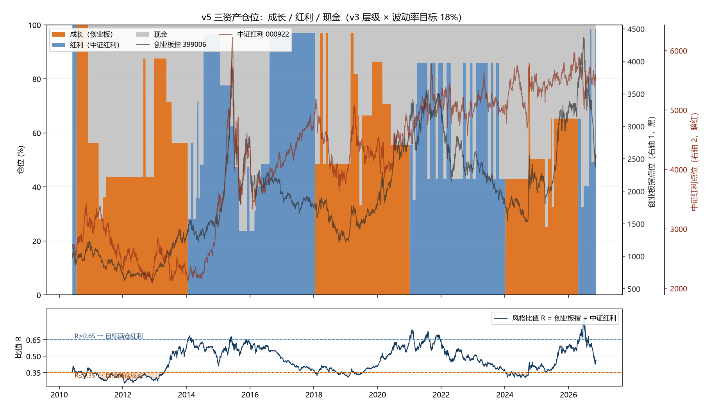

# 成长/红利轮动 · v5 每日状态（2026-11-12）

> 生成 2026-11-12 14:35 · 数据 2010-06-01~2026-11-12（3994 交易日）· 成长=创业板指(399006) ÷ 红利=中证红利(000922)
> 三层叠加：R 水位（0.35/0.65）+ 双侧 MA200 闸门（破线该侧 ×0.5）+ 波动率目标 18%（120 日，死区 0.15），全局限速 10 日。

## 一、今日状态

- 当前权重：成长 **0%** / 红利 **99%** / 现金 **1%**（总暴露 99%）
- 今日缩放系数：98%　已实现波动：10.0%
- 明日动作：**不动** —— 三层目标与当前权重一致，无需调仓
- 明日目标：成长 0% / 红利 99% / 现金 1%（目标系数 98%）

## 二、三层读数

| 层 | 读数 | 判读 |
|---|---|---|
| R 水位 | 0.4577 | 0.35~0.65 保持原侧 |
| 趋势（成长） | 创业板指 2514.35 vs MA200 3448.21 | **破线，成长侧减半** |
| 趋势（红利） | 中证红利 5494.03 vs MA200 5594.83 | **破线，红利侧减半** |
| 波动 | 已实现 10.0% vs 目标 18% | 缩放 98%（死区 0.15，跨档才动） |
| 限速 | 距上次调仓 5 个交易日 | 门槛 10 日 |

## 三、最近调仓

| 日期 | 成长 | 红利 | 现金 | 换手 | 动作 |
|---|---:|---:|---:|---:|---|
| 2026-09-08 | 0% | 99% | 1% | 35% | 加仓红利（0%/81%/19% →） |
| 2026-09-22 | 0% | 49% | 51% | 99% | 减仓红利（0%/99%/1% →） |
| 2026-11-05 | 0% | 99% | 1% | 99% | 加仓红利（0%/49%/51% →） |

> 机械规则输出，非投资建议。v5 全期 +14.23% / -26.74% / Calmar 0.53（家族最优），但平均只在场 63%、年化比 v3 少 1.4pp —— 波动层是**常驻的风险预算**，不是偶发的刹车。
