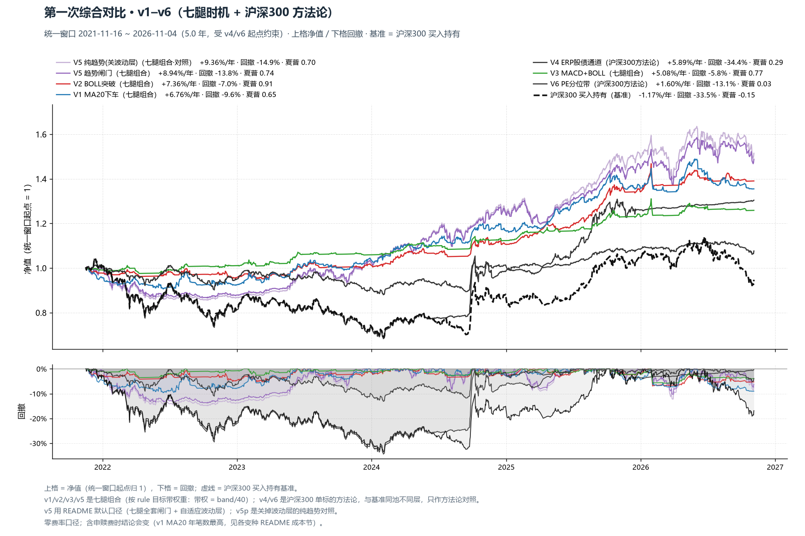
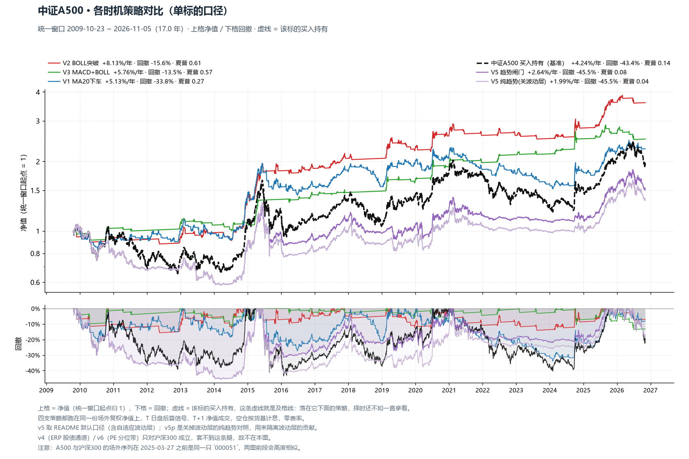
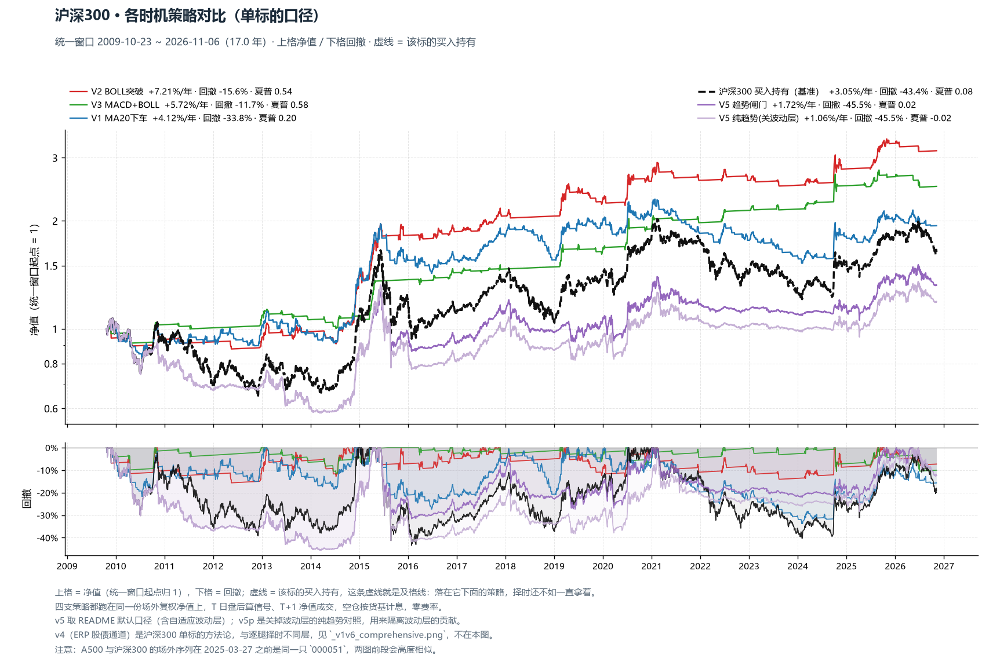
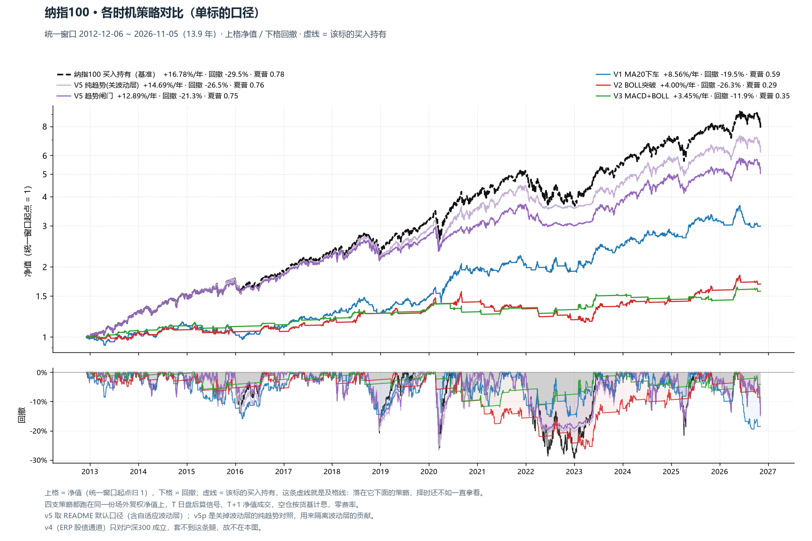
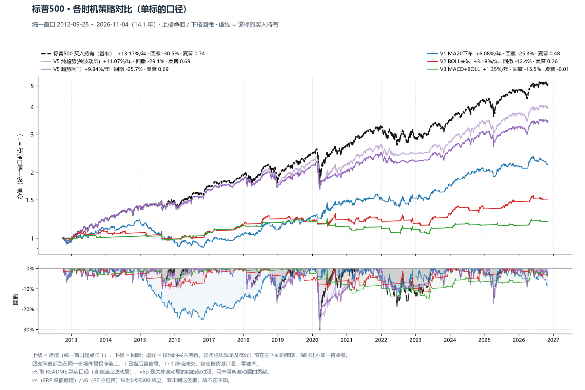
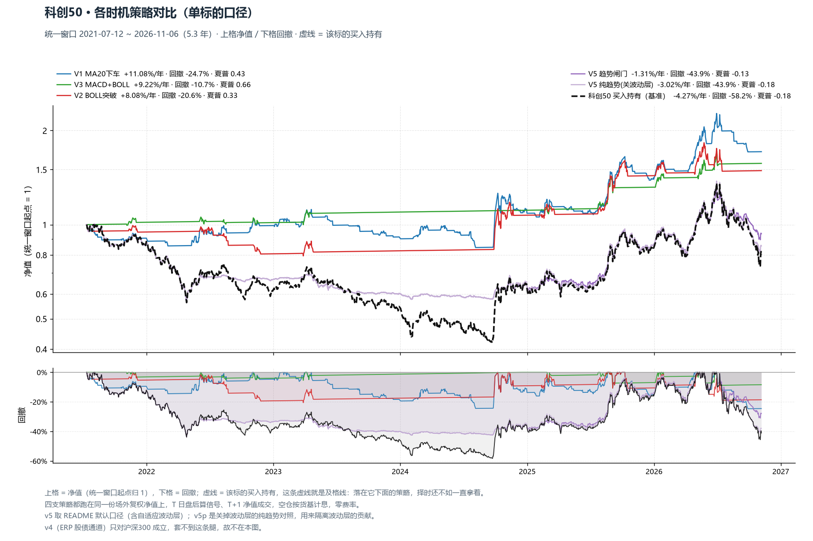
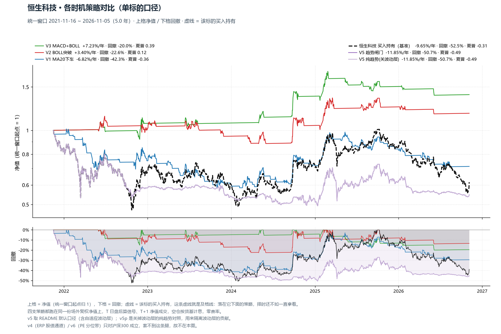
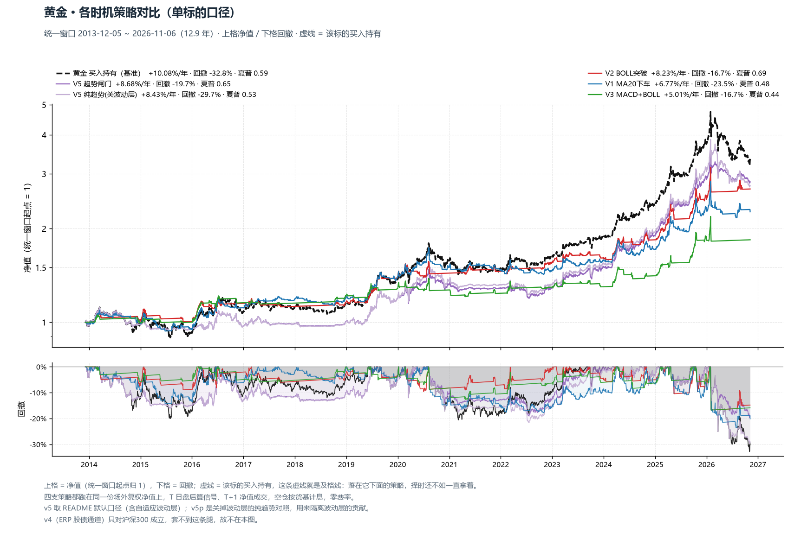
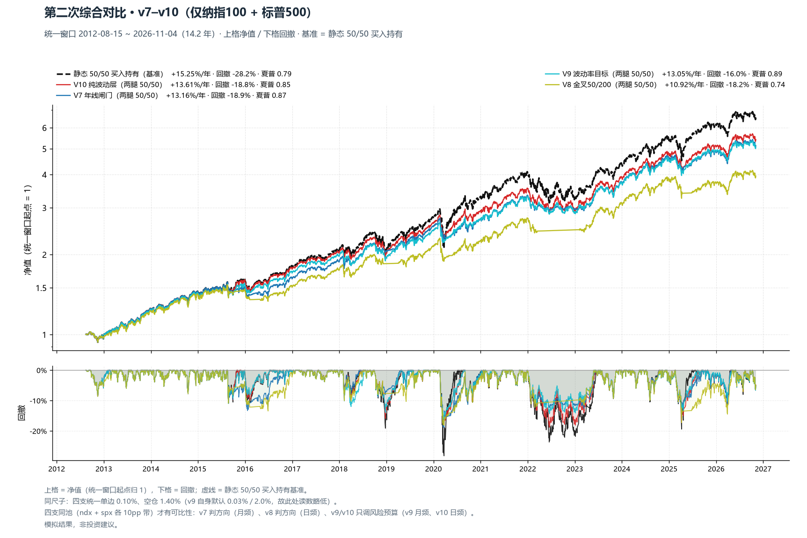

# 波动资产 · 变种横向对比（两次综合对比 · v1–v10）

> 家族有 10 个变种，但**标的池不是同一个**，所以拆成两次综合对比：
> **第一组 v1–v6 × 全部七腿**、**第二组 v7–v10 × 仅纳指100 + 标普500**。
> 价格 = 场外**复权净值**（含分红再投 / 汇率 / 跟踪误差）；成交 = T 日盘后算信号、T+1 净值成交；空仓按货基 1.40% 计息。
> 第一组零费率（与各变种回测主表一致）；第二组统一单边 0.10%（与各变种 README 的「同尺子」表一致）。

## 1. 第一次综合对比 · v1–v6（七腿时机 + 沪深300 方法论）

统一窗口 **2021-11-16 ~ 2026-11-04**（5.0 年；受 v4/v6 起点约束）。上格净值、下格回撤，虚线 = 沪深300 买入持有基准。

| 策略 | 类型 | 年化 | 最大回撤 | 夏普 | Calmar | 波动 | vs 沪深300 年化差 |
|---|---|---:|---:|---:|---:|---:|---:|
| V5 纯趋势(关波动层) | 七腿组合 | 9.36% | -14.88% | 0.70 | 0.63 | 11.40% | **+10.53pp** |
| V5 趋势闸门 | 七腿组合 | 8.94% | -13.79% | 0.74 | 0.65 | 10.21% | **+10.11pp** |
| V2 BOLL突破 | 七腿组合 | 7.36% | -6.96% | 0.91 | 1.06 | 6.54% | **+8.53pp** |
| V1 MA20下车 | 七腿组合 | 6.76% | -9.65% | 0.65 | 0.70 | 8.21% | **+7.93pp** |
| V4 ERP股债通道 | 沪深300方法论 | 5.89% | -34.40% | 0.29 | 0.17 | 15.45% | **+7.06pp** |
| V3 MACD+BOLL | 七腿组合 | 5.08% | -5.80% | 0.77 | 0.88 | 4.76% | **+6.25pp** |
| V6 PE分位带 | 沪深300方法论 | 1.60% | -13.14% | 0.03 | 0.12 | 7.14% | **+2.77pp** |
| 沪深300 买入持有（基准） | — | -1.17% | -33.46% | -0.15 | -0.03 | 17.03% | — |

> v1/v2/v3/v5 是**七腿组合**（按 `rule` 目标带权重：带权 = band/40，满仓 = 40pp）；v4/v6 是**沪深300 单标的方法论**，与基准同池、不同层，只作方法论对照，不与七腿组合比排名。
> v5 取 README 默认口径（七腿全套闸门 + 自适应波动层）；**v5p = 关掉波动层的纯趋势对照**，用来隔离「波动层到底贡献了什么」。

### 1.1 逐腿最优策略（同窗口内比较）

| 标的 | 买入持有 年化/回撤/夏普 | 推荐策略 | V1 MA20下车 | V2 BOLL突破 | V3 MACD+BOLL | V5 趋势闸门 |
|---|---:|---:|---:|---:|---:|---:|
| 中证A500 | 4.24%/-43.43%/0.14 | **V2 BOLL突破** | 5.13%/-33.77%/0.27(+0.9) | 8.13%/-15.65%/0.61(+3.9) | 5.76%/-13.53%/0.57(+1.5) | 2.64%/-45.54%/0.08(-1.6) |
| 沪深300 | 3.14%/-43.43%/0.08 | **V2 BOLL突破** | 4.12%/-33.77%/0.20(+1.0) | 7.21%/-15.65%/0.54(+4.1) | 5.73%/-11.66%/0.58(+2.6) | 1.74%/-45.54%/0.02(-1.4) |
| 纳指100 | 17.35%/-29.47%/0.81 | **买入持有** | 8.57%/-19.48%/0.59(-8.8) | 4.00%/-26.31%/0.29(-13.4) | 3.45%/-11.92%/0.35(-13.9) | 13.41%/-21.32%/0.79(-3.9) |
| 标普500 | 13.17%/-30.50%/0.74 | **买入持有** | 6.08%/-25.25%/0.48(-7.1) | 3.18%/-12.36%/0.26(-10.0) | 1.35%/-15.46%/-0.01(-11.8) | 9.84%/-25.69%/0.69(-3.3) |
| 科创50 | -3.81%/-58.25%/-0.17 | **V1 MA20下车** | 11.08%/-24.66%/0.43(+14.9) | 8.09%/-20.58%/0.33(+11.9) | 9.23%/-10.74%/0.66(+13.0) | -1.22%/-43.87%/-0.13(+2.6) |
| 恒生科技 | -9.65%/-52.49%/-0.31 | **V3 MACD+BOLL** | -6.82%/-42.31%/-0.36(+2.8) | 3.40%/-22.60%/0.12(+13.0) | 7.23%/-20.00%/0.39(+16.9) | -11.85%/-50.67%/-0.49(-2.2) |
| 黄金 | 10.24%/-32.78%/0.60 | **V5 趋势闸门** | 6.92%/-23.46%/0.49(-3.3) | 8.23%/-16.71%/0.69(-2.0) | 5.02%/-16.71%/0.44(-5.2) | 8.71%/-19.69%/0.65(-1.5) |

> 单元格 = 年化 / 最大回撤 / 夏普（括号内 = 年化超额 pp vs 买入持有），全部为**同窗口**口径。
> 推荐 = v1/v2/v3/v5 中同窗口年化超额最高者；若最好的时机策略仍跑输买入持有 >2pp，回退到**买入持有**（典型如美股长牛，减仓纯拖累）。
> **v5 列 = README 默认口径**（`GATE_ALL=True` 七腿全套闸门 + `VOL_USE=True` 自适应波动层）；它和自己回测报告的差异只来自窗口与费率，逐腿对上见 §1.2。
> ⚠ A500 与沪深300 两列互为镜像（2025-03-27 前两条腿场外序列同源自 `000051`），不是两份独立证据。

### 1.2 口径核对（本表 vs 各变种自己的默认回测）

**结论：10 个变种的规则与参数都对得上各自默认，差异只有「费率」与「窗口」两类，逐条列在下面。**

| 变种 | 本表怎么算 | 该变种自己的默认口径 | 对得上？ |
|---|---|---|---|
| V1 MA20 | `ma20.signal / run`，零费 | 回测主表就是零费（`ann_fee` 另列一列） | ✅ 规则一致，仅窗口 |
| V2 BOLL | `boll.signal / run`，零费 | 同上 | ✅ 仅窗口 |
| V3 MACD+BOLL | `macd_boll.leg_slice / run`，零费 | 同上（`leg_slice` 自带预热截断） | ✅ 仅窗口 |
| V4 ERP 通道 | `ladder.frame()` 的 `target`（两带滞回 hold_left）＋**零费** | 同规则、**含费** 0.10% / 0.50% | ⚠ 仅费率：零费 +11.97% vs 含费 +11.27%（15.4 年） |
| V5 趋势闸门 | `state_machine` 默认（`GATE_ALL` + `VOL_USE`）＋零费＋**全段起算** | 同规则、含费 + 双边滑点 0.10%、**预热 269 日后**起算 | ⚠ 费率＋窗口（逐腿表见 1.2.1） |
| V6 PE 分位带 | `params()` 默认（weekly / 10 年窗口 / 档位表 / 阶梯 / RSI 扳机 / 利差否决）＋零费 | 同规则、含费 | ⚠ 仅费率：零费 +3.92% vs 含费 +3.81%（21.8 年） |
| V7 年线闸门 | `build` 默认参数，成本 0.10%、空仓 1.40% | 同 | ✅ 完全一致 |
| V8 金叉 50/200 | 同上 | 同 | ✅ 完全一致 |
| V9 波动率目标 | 成本 0.10%、空仓 1.40%（统一尺子） | **0.03% / 2.0%** | ⚠ 仅费率：+13.05% vs +13.24%（14.2 年） |
| V10 纯波动层 | 成本 0.10%、空仓 1.40% | 同 | ✅ 完全一致 |

> 为什么统一成零费/同一费率：横向比较**必须同尺子**，否则比的是费率差不是规则差。各变种自身的报告仍用各自的默认成本，读「这条规则本身值多少」时以那边为准。

#### 1.2.1 本次核对修掉的两处真错

1. **V4 之前画的是旧口径**：`erp_frame()['target']` 是引擎自带的**百分位 + 趋势过滤 80/50/20 阶梯**（15.4 年零费 +5.50%），不是 v4 默认的两带滞回（同区间零费 **+11.97%**）。已改为 `ladder.frame()['target']`，§1 表里 v4 的读数随之从 2.40% 修正为现在的数。
2. **V6 之前被单方面扣费**：`simulate()` 默认扣 `rule.FEE_BUY/FEE_SELL`，而其它九支在表里是零费 —— 已显式置零；同时按 v6 自己的 `run_mode` 用「首个有效 PE 分位」起算，不再把前面无分位的空仓段计入。

#### 1.2.2 v5 的两套口径（逐腿对号）

本表的 v5 就是 **README 默认口径**（`GATE_ALL=True` 七腿全套闸门 + `VOL_USE=True` 自适应波动层），规则与 `v5_trend_gate/backtest/_v5_trend_gate_bt.md` 相同；数字不同只来自窗口与费率两项：

| 项 | 本表（§1.1） | v5 自己的回测报告 |
|---|---|---|
| 样本起点 | 四支策略的**共同窗口**（v1/v2/v3 能跑的最早一天，v5 的预热段一并计入） | 预热完成起（`WARMUP=269` 个交易日之后） |
| 费率 | **零费率**（与 v1/v2/v3 的回测主表一致） | 真实申赎费 + 双边滑点 0.10% |

| 腿 | 本表 年化/回撤/夏普 | v5 自身口径 年化/回撤/夏普 | 自身样本区间 | 年化差 |
|---|---:|---:|---|---:|
| 中证A500 | 2.64%/-45.54%/0.08 | 3.51%/-37.12%/0.15 | 2010-08-27 ~ 2026-11-05（16.19 年） | +0.87pp |
| 沪深300 | 1.74%/-45.54%/0.02 | 1.29%/-40.22%/-0.01 | 2010-08-27 ~ 2026-11-05（16.19 年） | -0.45pp |
| 纳指100 | 13.41%/-21.32%/0.79 | 11.38%/-21.53%/0.65 | 2013-10-28 ~ 2026-11-04（13.02 年） | -2.04pp |
| 标普500 | 9.84%/-25.69%/0.69 | 8.38%/-26.64%/0.57 | 2013-08-29 ~ 2026-11-04（13.18 年） | -1.46pp |
| 科创50 | -1.22%/-43.87%/-0.13 | 8.71%/-31.19%/0.37 | 2022-05-25 ~ 2026-11-05（4.45 年） | +9.93pp |
| 恒生科技 | -11.85%/-50.67%/-0.49 | -3.00%/-26.79%/-0.22 | 2022-09-22 ~ 2026-11-05（4.12 年） | +8.84pp |
| 黄金 | 8.71%/-19.69%/0.65 | 7.69%/-21.97%/0.56 | 2014-10-16 ~ 2026-11-05（12.05 年） | -1.02pp |

> 差得最多的是**科创50 与恒生科技**：这两条腿的场外序列 2020-11 / 2021-08 才成立，`WARMUP=269` 个交易日把起点推到 2022-05 / 2022-09，正好**跳过 2021-2022 的主跌段**；本表为了四支同窗口，把这段含了进来（科创50 自 2021-07-12、恒生科技自 2021-11-16）。
> 还有一个不对称：**波动层的参考分位要 500 日历史**，科创50 直到 2024-10-08 才第一次压仓 ——长窗口的前三年里它是空转的。所以本表里 v5 相对 v5p（关波动层）的优势被摊薄（科创50 同窗口 −1.22% vs −2.93%，仍 +1.71pp），而 v5 自己的报告是 +2.15pp。
> 一句话：**读「这条腿该不该套闸门」看 §1.1（同窗口、同费率，横向可比）；读「v5 这套规则自己跑出什么」看 `_v5_trend_gate_bt.md`（预热后、含费，纵向可比）**。两套数字都对，别混着比。

### 1.3 逐腿策略对比图（单标的口径 · 版式同沪深300 那张）

每张图 = 一条腿：上格净值（该腿买入持有 = 虚线基准）+ 四支时机策略，下格回撤。
与 §1 组合层图的区别在及格线 —— 这里的基准是**该标的自己**，所以能直接看出「这条腿上，择时到底赢没赢过一直拿着」。

> v4/v6 只对沪深300 成立（ERP 股债通道、PE 分位带），不进这些图；要看 v4/v6 请回 §1 的组合层对比图。
> 判读：策略线在虚线之上 = 该腿存在时机红利；全线在虚线之下 = 这条腿适合买入持有（典型如纳指/标普的长牛段）。

## 2. 第二次综合对比 · v7–v10（仅纳指100 + 标普500）

统一窗口 **2012-08-15 ~ 2026-11-04**（14.2 年）。上格净值、下格回撤，虚线 = 静态 50/50 买入持有基准。

| 组合（两腿 50/50） | 年化 | 最大回撤 | 夏普 | Calmar | 波动 | 平均仓位 | vs 静态 年化差 |
|---|---:|---:|---:|---:|---:|---:|---:|
| 静态 50/50 买入持有（基准） | 15.25% | -28.17% | 0.79 | 0.54 | 17.56% | 100% | **+0.00pp** |
| V10 纯波动层 | 13.61% | -18.78% | 0.85 | 0.72 | 14.31% | 92% | **-1.64pp** |
| V7 年线闸门 | 13.16% | -18.90% | 0.87 | 0.70 | 13.54% | 88% | **-2.08pp** |
| V9 波动率目标 | 13.05% | -15.98% | 0.89 | 0.82 | 13.12% | 89% | **-2.20pp** |
| V8 金叉50/200 | 10.92% | -18.15% | 0.74 | 0.60 | 12.85% | 81% | **-4.32pp** |

### 2.1 逐腿（同池四支变种）

| 腿 | 变种 | 年化 | 最大回撤 | 夏普 | Calmar | 买入持有 年化/回撤/夏普 | 年化差 | 调仓 总数(≥20pp) | 平均仓位 |
|---|---|---:|---:|---:|---:|---:|---:|---:|---:|
| 纳指100 | V10 纯波动层 | 14.79% | -22.42% | 0.85 | 0.66 | 16.63%/-29.47%/0.78 | -1.85pp | 103(7) | 90% |
| 纳指100 | V7 年线闸门 | 14.13% | -20.96% | 0.83 | 0.67 | 16.63%/-29.47%/0.78 | -2.50pp | 42(25) | 84% |
| 纳指100 | V9 波动率目标 | 13.92% | -16.40% | 0.87 | 0.85 | 16.63%/-29.47%/0.78 | -2.71pp | 160(45) | 85% |
| 纳指100 | V8 金叉50/200 | 12.07% | -17.57% | 0.73 | 0.69 | 16.63%/-29.47%/0.78 | -4.56pp | 94(21) | 79% |
| 标普500 | V10 纯波动层 | 12.11% | -19.73% | 0.80 | 0.61 | 13.42%/-30.50%/0.76 | -1.31pp | 54(7) | 95% |
| 标普500 | V9 波动率目标 | 11.87% | -17.21% | 0.85 | 0.69 | 13.42%/-30.50%/0.76 | -1.55pp | 91(24) | 92% |
| 标普500 | V7 年线闸门 | 11.83% | -17.48% | 0.82 | 0.68 | 13.42%/-30.50%/0.76 | -1.59pp | 28(20) | 92% |
| 标普500 | V8 金叉50/200 | 9.52% | -19.73% | 0.68 | 0.48 | 13.42%/-30.50%/0.76 | -3.90pp | 38(16) | 83% |

> 同尺子：四支统一单边 0.10% / 空仓 1.40%（v9 自身默认 0.03% / 2.0%，故本表 v9 读数略低于它自己的 README 表）。
> 四支同池才有可比性：v7 判方向（月频，2 月确认）、v8 判方向（日频，教科书基线）、v9/v10 只调风险预算（v9 月频 + 月中补丁、v10 日频）。
> 「调仓(≥20pp)」= 总调仓次数（括号内 = 其中仓位变动 ≥20pp 的大动作数）。

## 3. 跨组结论

### 3.1 七腿（v1–v6）

- **逐腿推荐**：中证A500→V2 BOLL突破、沪深300→V2 BOLL突破、纳指100→买入持有、标普500→买入持有、科创50→V1 MA20下车、恒生科技→V3 MACD+BOLL、黄金→V5 趋势闸门。
- **回退到买入持有**：纳指100 / 标普500 —— 长牛里任何减仓都是纯拖累，时机策略的年化超额为负。
- **A 股宽基（A500 / 沪深300）**：BOLL 突破（v2）通常最稳 —— 年化超额为正且回撤压得最狠。
- **港股（恒生科技）与科创50**：波动最大、时机红利最高（超额两位数 pp 的常客），但绝对回撤仍大。
- **v4 / v6 不是择时**：它们是「沪深300 与国债之间摆多少」「这笔钱最多投几成」，只应与沪深300 基准对照，不要拿去和七腿组合比排名。

### 3.2 美股两腿（v7–v10）

- **夏普排序**：V9 波动率目标 0.89 > V7 年线闸门 0.87 > V10 纯波动层 0.85 > V8 金叉50/200 0.74（基准静态 0.79）。
- **年化排序通常与回撤排序相反**：降风险换来的平滑就是「牛市持续少赚」，看下格回撤带才公平。
- **频率决定成本**：v8/v10 日频换手最高，v7/v9 月频换手低 —— 场外 A 类费率下这一条能吃掉半年的超额。
- **2020 型 5 周急跌是月频策略的结构性缺口**，v9/v10 靠月中/日频补丁才补得上；2000-2002 与 2008 不在 QDII 样本内，结论对下一次泡沫破裂属外推（长样本证据见 `research/probe_us_gate_vs_vt/_probe_us_gate_vs_vt.md`、`research/probe_published_us/_probe_published_us.md`）。

## 4. 图表

- 第一组分面 · 中证A500（v1/v2/v3/v5）：`_v1v6_leg_a500.png`
- 第一组分面 · 沪深300（v1/v2/v3/v5）：`_v1v6_leg_hs300.png`
- 第一组分面 · 纳指100（v1/v2/v3/v5）：`_v1v6_leg_ndx.png`
- 第一组分面 · 标普500（v1/v2/v3/v5）：`_v1v6_leg_spx.png`
- 第一组分面 · 科创50（v1/v2/v3/v5）：`_v1v6_leg_kc50.png`
- 第一组分面 · 恒生科技（v1/v2/v3/v5）：`_v1v6_leg_hkt.png`
- 第一组分面 · 黄金（v1/v2/v3/v5）：`_v1v6_leg_gold.png`
- 第一组综合对比（组合层 · 净值 + 回撤）：`_v1v6_comprehensive.png`
- 单腿策略对比 · 中证A500：`_v1v6_overlay_a500.png`
- 单腿策略对比 · 沪深300：`_v1v6_overlay_hs300.png`
- 单腿策略对比 · 纳指100：`_v1v6_overlay_ndx.png`
- 单腿策略对比 · 标普500：`_v1v6_overlay_spx.png`
- 单腿策略对比 · 科创50：`_v1v6_overlay_kc50.png`
- 单腿策略对比 · 恒生科技：`_v1v6_overlay_hkt.png`
- 单腿策略对比 · 黄金：`_v1v6_overlay_gold.png`
- 第二组分面 · 纳指100（v7/v8/v9/v10）：`_v7v10_leg_ndx.png`
- 第二组分面 · 标普500（v7/v8/v9/v10）：`_v7v10_leg_spx.png`
- 第二组综合对比（净值 + 回撤）：`_v7v10_comprehensive.png`

> 模拟结果，非投资建议。