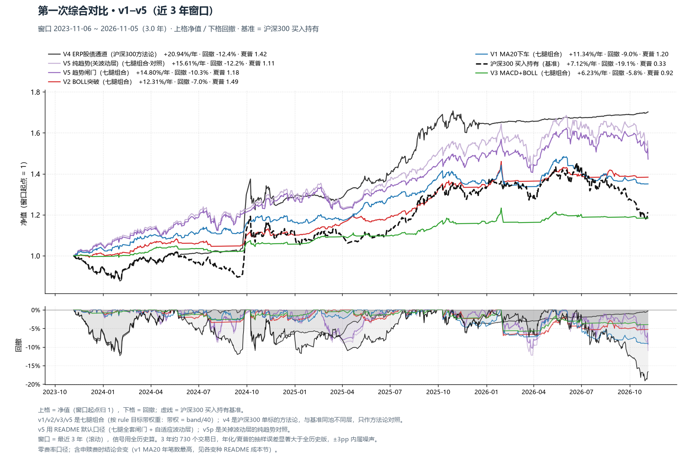
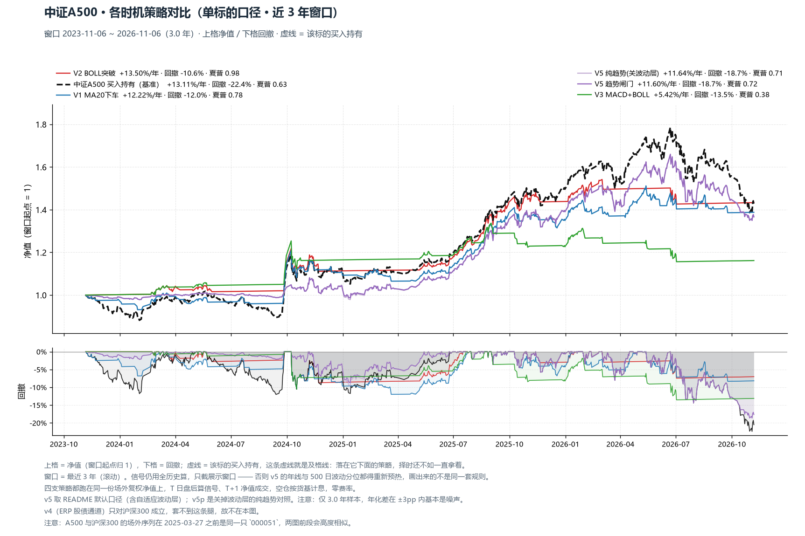
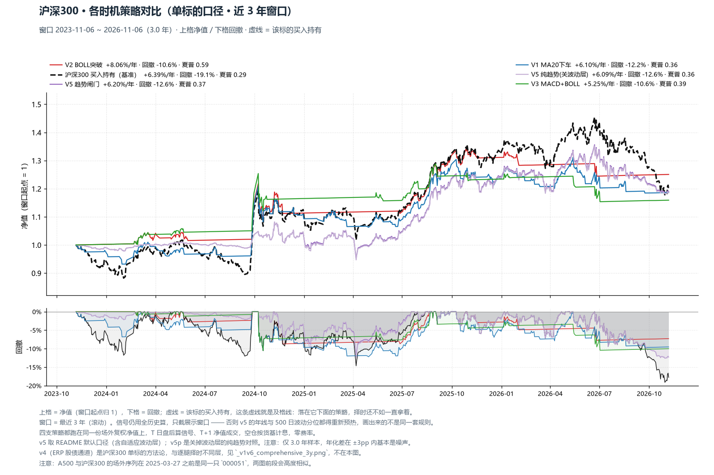
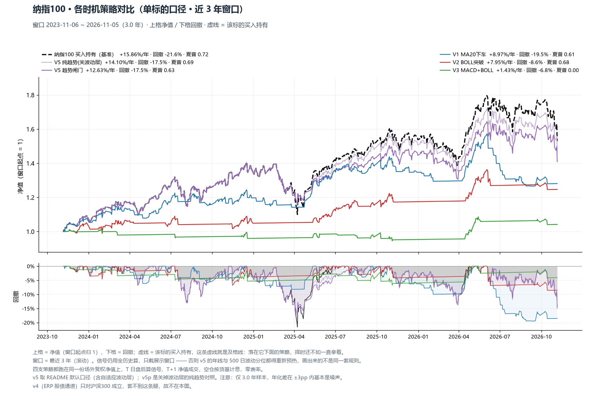
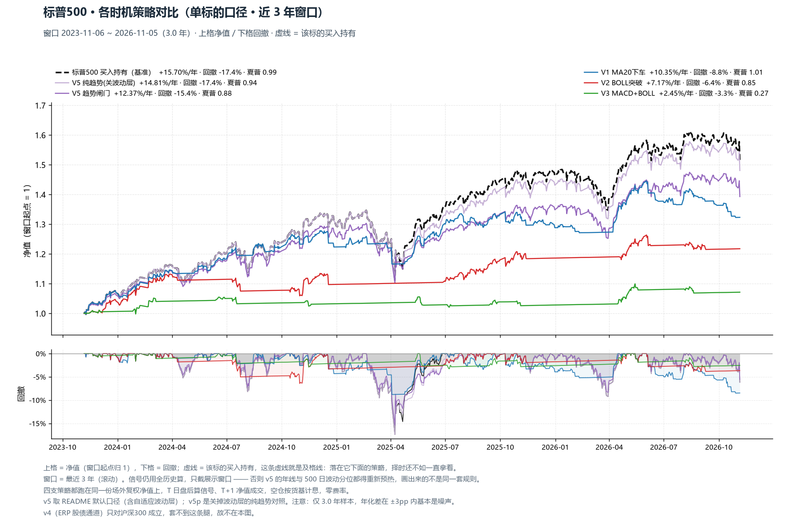
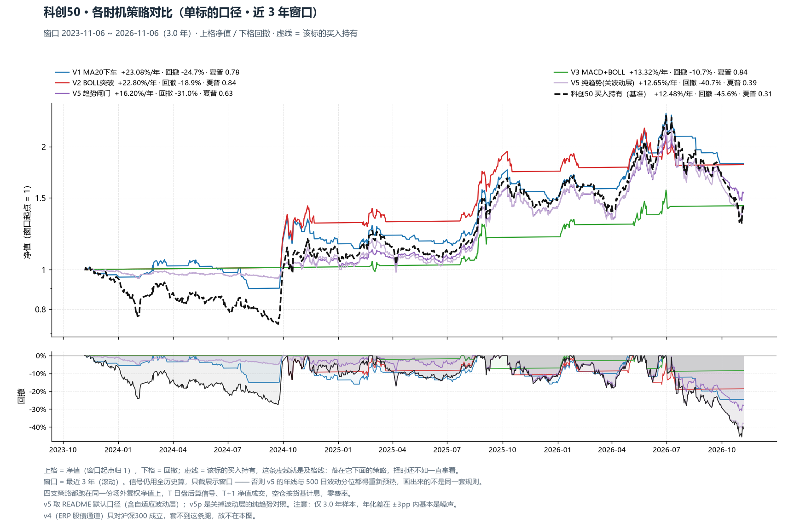
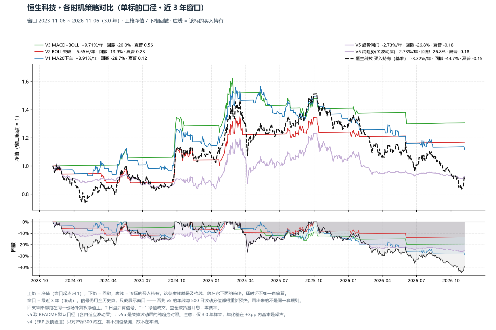
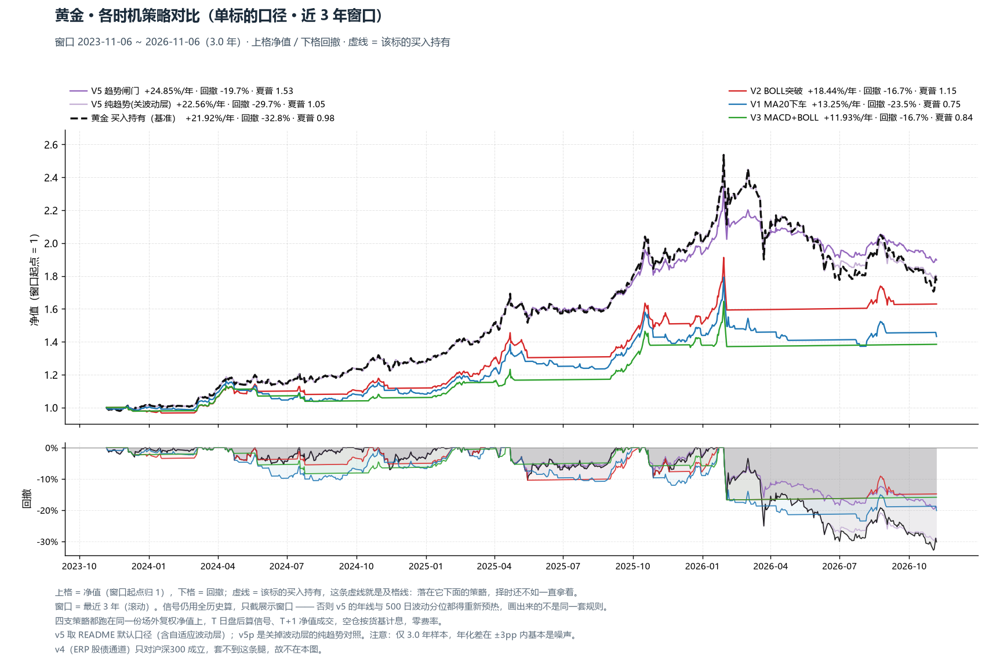
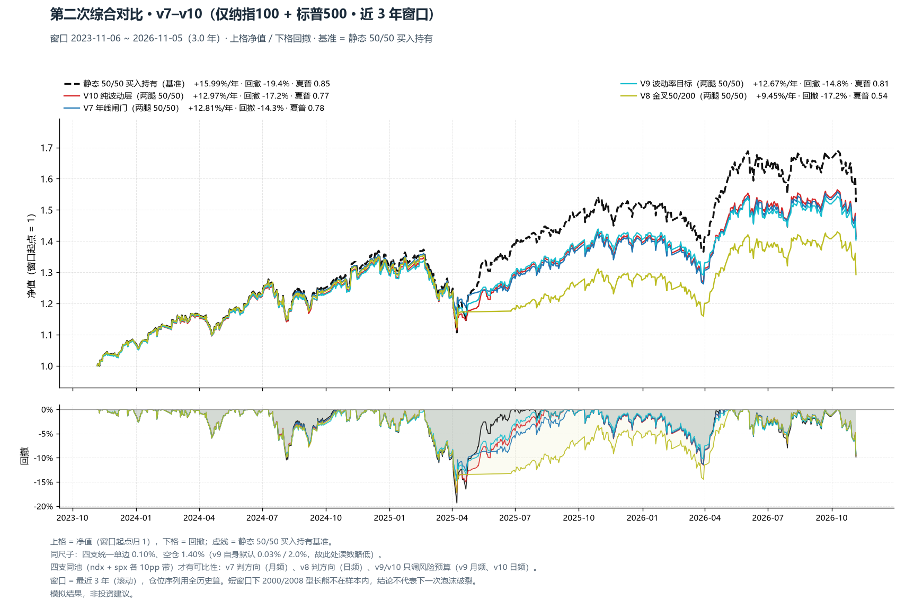

# 波动资产 · 变种横向对比（**近 3 年窗口** · v1–v10）

> 本目录 = `research/v1v10_compare/` 的**同一套图、只换窗口**：全历史版看「十几年长跑谁活得久」，这里只画**最近 3 年**，看「按当下的市场状态，这套规则还在不在状态」。
> 仍按标的池拆两次：**第一组 v1–v5 × 全部七腿**、**第二组 v7–v10 × 仅纳指100 + 标普500**。
> 价格 = 场外**复权净值**（含分红再投 / 汇率 / 跟踪误差）；成交 = T 日盘后算信号、T+1 净值成交；空仓按货基 1.40% 计息。第一组零费率；第二组统一单边 0.10%。

## 0. 口径：全历史算信号，近 3 年看结果

- **展示与统计窗口** = 每条序列尾部 3 年，各净值在窗口起点重归 1；
- **信号一律用全历史算**：年线闸门要 250 日预热、v5 自适应波动层要 500 日分位、v4 的 ERP 通道要 250 日均值 —— 只喂 3 年数据会让它们长期空转 / 档位失真，那画出来的就不是「近 3 年的表现」，而是「换了一套参数的另一个策略」；
- ⚠ **短样本**：3 年约 730 个交易日，年化与夏普的抽样误差远大于全历史版。单腿年化差在 **±3pp 内基本是噪声**，不要把本目录的数字与全历史版逐位对比；
- 想读「规则本身值多少」请看 `research/v1v10_compare/_v1v10_compare.md`（长样本）；本目录只回答「最近三年这套规则表现如何」。

## 1. 第一次综合对比 · v1–v5（七腿时机 + 沪深300 方法论）

窗口 **2023-11-06 ~ 2026-11-05**（3.0 年）。上格净值、下格回撤，虚线 = 沪深300 买入持有基准。

| 策略 | 类型 | 年化 | 最大回撤 | 夏普 | Calmar | 波动 | vs 沪深300 年化差 |
|---|---|---:|---:|---:|---:|---:|---:|
| V4 ERP股债通道 | 沪深300方法论 | 20.94% | -12.36% | 1.42 | 1.69 | 13.79% | **+13.82pp** |
| V5 纯趋势(关波动层) | 七腿组合 | 15.61% | -12.23% | 1.11 | 1.28 | 12.83% | **+8.49pp** |
| V5 趋势闸门 | 七腿组合 | 14.80% | -10.33% | 1.18 | 1.43 | 11.38% | **+7.68pp** |
| V2 BOLL突破 | 七腿组合 | 12.31% | -6.96% | 1.49 | 1.77 | 7.31% | **+5.18pp** |
| V1 MA20下车 | 七腿组合 | 11.34% | -9.05% | 1.20 | 1.25 | 8.28% | **+4.22pp** |
| V3 MACD+BOLL | 七腿组合 | 6.23% | -5.80% | 0.92 | 1.07 | 5.24% | **-0.89pp** |
| 沪深300 买入持有（基准） | — | 7.12% | -19.11% | 0.33 | 0.37 | 17.22% | — |

> v1/v2/v3/v5 是**七腿组合**（按 `rule` 目标带权重：带权 = band/40，满仓 = 40pp）；v4 是**沪深300 单标的方法论**，与基准同池、不同层，只作方法论对照，不与七腿组合比排名。
> v5 取 README 默认口径（七腿全套闸门 + 自适应波动层）；**v5p = 关掉波动层的纯趋势对照**。
> 七腿组合在窗口起点按目标带权重新归 1（等价于「三年前的今天等权建仓」），不是真的持有三年不动 —— 这是滚动窗口对比的固有口径。

### 1.1 逐腿最优策略（同窗口内比较）

| 标的 | 买入持有 年化/回撤/夏普 | 推荐策略 | V1 MA20下车 | V2 BOLL突破 | V3 MACD+BOLL | V5 趋势闸门 |
|---|---:|---:|---:|---:|---:|---:|
| 中证A500 | 13.11%/-22.40%/0.63 | **V2 BOLL突破** | 12.22%/-11.98%/0.78(-0.9) | 13.50%/-10.56%/0.98(+0.4) | 5.42%/-13.53%/0.38(-7.7) | 11.60%/-18.65%/0.72(-1.5) |
| 沪深300 | 6.39%/-19.11%/0.29 | **V2 BOLL突破** | 6.10%/-12.20%/0.36(-0.3) | 8.06%/-10.56%/0.59(+1.7) | 5.25%/-10.56%/0.39(-1.1) | 6.20%/-12.61%/0.37(-0.2) |
| 纳指100 | 15.86%/-21.63%/0.72 | **买入持有** | 8.97%/-19.48%/0.61(-6.9) | 7.95%/-8.59%/0.68(-7.9) | 1.43%/-6.79%/0.00(-14.4) | 12.63%/-17.53%/0.63(-3.2) |
| 标普500 | 15.70%/-17.40%/0.99 | **买入持有** | 10.35%/-8.81%/1.01(-5.3) | 7.17%/-6.44%/0.85(-8.5) | 2.45%/-3.28%/0.27(-13.2) | 12.37%/-15.43%/0.88(-3.3) |
| 科创50 | 12.48%/-45.61%/0.31 | **V1 MA20下车** | 23.08%/-24.66%/0.78(+10.6) | 22.80%/-18.95%/0.84(+10.3) | 13.32%/-10.74%/0.84(+0.8) | 16.20%/-31.05%/0.63(+3.7) |
| 恒生科技 | -3.32%/-44.74%/-0.15 | **V3 MACD+BOLL** | 3.91%/-28.68%/0.12(+7.2) | 5.55%/-13.87%/0.23(+8.9) | 9.71%/-20.00%/0.56(+13.0) | -2.73%/-26.79%/-0.18(+0.6) |
| 黄金 | 21.92%/-32.78%/0.98 | **V5 趋势闸门** | 13.25%/-23.46%/0.75(-8.7) | 18.44%/-16.71%/1.15(-3.5) | 11.93%/-16.71%/0.84(-10.0) | 24.85%/-19.69%/1.53(+2.9) |

> 单元格 = 年化 / 最大回撤 / 夏普（括号内 = 年化超额 pp vs 买入持有），全部为**同窗口**口径。
> 推荐 = v1/v2/v3/v5 中同窗口年化超额最高者；若最好的时机策略仍跑输买入持有 >2pp，回退到**买入持有**（典型如美股长牛，减仓纯拖累）。
> ⚠ 3 年窗口的噪声：一条腿 3 年内可能只经历一个半周期，某一支策略「恰好躲过一次急跌」就能拿到 +15pp 的超额。**逐腿推荐只作参考，不要据此判断规则优劣**（长样本见全历史版）。
> ⚠ A500 与沪深300 两列互为镜像（2025-03-27 前两条腿场外序列同源自 `000051`），不是两份独立证据。

### 1.2 口径核对（本表 vs 各变种自己的默认回测）

**结论：规则与参数都对得上各自默认，差异只有「费率」与「窗口」两类。**

| 变种 | 本表怎么算 | 该变种自己的默认口径 | 对得上？ |
|---|---|---|---|
| V1 MA20 | `ma20.signal / run`，零费，窗口截 3 年 | 回测主表就是零费（`ann_fee` 另列一列） | ✅ 规则一致，仅窗口 |
| V2 BOLL | `boll.signal / run`，零费 | 同上 | ✅ 仅窗口 |
| V3 MACD+BOLL | `macd_boll.leg_slice / run`，零费 | 同上（`leg_slice` 自带预热截断） | ✅ 仅窗口 |
| V4 ERP 通道 | `ladder.frame()` 的 `target`（两带滞回 hold_left）＋**零费** | 同规则、**含费** 0.10% / 0.50% | ⚠ 仅费率 |
| V5 趋势闸门 | `state_machine` 默认（`GATE_ALL` + `VOL_USE`）＋零费＋**全段起算** | 同规则、含费 + 双边滑点 0.10%、**预热 269 日后**起算 | ⚠ 费率＋窗口（见 §1.2.1） |
| V7 年线闸门 | `build` 默认参数，成本 0.10%、空仓 1.40% | 同 | ✅ 完全一致 |
| V8 金叉 50/200 | 同上 | 同 | ✅ 完全一致 |
| V9 波动率目标 | 成本 0.10%、空仓 1.40%（统一尺子） | **0.03% / 2.0%** | ⚠ 仅费率 |
| V10 纯波动层 | 成本 0.10%、空仓 1.40% | 同 | ✅ 完全一致 |

> 横向比较必须同尺子（同窗口、同费率），否则比的是费率差不是规则差。各变种自身的报告仍用各自的默认成本与全段窗口。

#### 1.2.1 v5 的费率影响（同一 3 年窗口）

两列**窗口完全相同**（都截最近 3 年、都在窗口起点归 1），差异只剩费率：本表零费，另一列是 v5 自身的真实申赎费 + 双边滑点 0.10%。

| 腿 | 本表（零费） 年化/回撤/夏普 | v5 含费 年化/回撤/夏普 | 年化差（费率成本） |
|---|---:|---:|---:|
| 中证A500 | 11.60%/-18.65%/0.72 | 11.45%/-18.74%/0.71 | -0.16pp |
| 沪深300 | 6.20%/-12.61%/0.37 | 5.39%/-13.65%/0.31 | -0.81pp |
| 纳指100 | 12.63%/-17.53%/0.63 | 11.62%/-18.67%/0.57 | -1.01pp |
| 标普500 | 12.37%/-15.43%/0.88 | 11.73%/-15.43%/0.83 | -0.64pp |
| 科创50 | 16.20%/-31.05%/0.63 | 15.92%/-31.19%/0.62 | -0.28pp |
| 恒生科技 | -2.73%/-26.79%/-0.18 | -3.16%/-26.79%/-0.20 | -0.44pp |
| 黄金 | 24.85%/-19.69%/1.53 | 23.36%/-21.95%/1.42 | -1.49pp |

> v5 自己的回测报告（`_v5_trend_gate_bt.md`）是**预热后全历史**口径，与这里的 3 年窗口不同，数字不能直接对上 —— 读「规则本身值多少」以那边为准。

### 1.3 逐腿策略对比图（单标的口径）

每张图 = 一条腿：上格净值（该腿买入持有 = 虚线基准）+ 四支时机策略，下格回撤。
基准是**该标的自己**，所以能直接看出「这条腿上，择时到底赢没赢过一直拿着」。

> v4 只对沪深300 成立（ERP 股债通道），不进这些图。
> 判读：策略线在虚线之上 = 这条腿近三年存在时机红利；全线在虚线之下 = 适合买入持有。

## 2. 第二次综合对比 · v7–v10（仅纳指100 + 标普500）

窗口 **2023-11-06 ~ 2026-11-05**（3.0 年）。上格净值、下格回撤，虚线 = 静态 50/50 买入持有基准。

| 组合（两腿 50/50） | 年化 | 最大回撤 | 夏普 | Calmar | 波动 | 平均仓位 | vs 静态 年化差 |
|---|---:|---:|---:|---:|---:|---:|---:|
| 静态 50/50 买入持有（基准） | 15.99% | -19.37% | 0.85 | 0.83 | 17.13% | 100% | **+0.00pp** |
| V10 纯波动层 | 12.97% | -17.24% | 0.77 | 0.75 | 15.08% | 90% | **-3.02pp** |
| V7 年线闸门 | 12.81% | -14.27% | 0.78 | 0.90 | 14.65% | 90% | **-3.18pp** |
| V9 波动率目标 | 12.67% | -14.78% | 0.81 | 0.86 | 13.85% | 85% | **-3.33pp** |
| V8 金叉50/200 | 9.45% | -17.24% | 0.54 | 0.55 | 14.86% | 87% | **-6.54pp** |

### 2.1 逐腿（同池四支变种）

| 腿 | 变种 | 年化 | 最大回撤 | 夏普 | Calmar | 买入持有 年化/回撤/夏普 | 年化差 | 调仓 总数(≥20pp) | 平均仓位 |
|---|---|---:|---:|---:|---:|---:|---:|---:|---:|
| 纳指100 | V10 纯波动层 | 12.69% | -17.57% | 0.65 | 0.72 | 16.10%/-21.63%/0.73 | -3.41pp | 24(1) | 90% |
| 纳指100 | V9 波动率目标 | 12.25% | -15.85% | 0.69 | 0.77 | 16.10%/-21.63%/0.73 | -3.85pp | 35(16) | 85% |
| 纳指100 | V7 年线闸门 | 11.54% | -13.78% | 0.60 | 0.84 | 16.10%/-21.63%/0.73 | -4.56pp | 10(4) | 90% |
| 纳指100 | V8 金叉50/200 | 9.39% | -17.57% | 0.47 | 0.53 | 16.10%/-21.63%/0.73 | -6.71pp | 23(2) | 87% |
| 标普500 | V7 年线闸门 | 13.80% | -17.40% | 0.87 | 0.79 | 15.70%/-17.40%/0.99 | -1.90pp | 2(2) | 98% |
| 标普500 | V10 纯波动层 | 13.12% | -17.19% | 0.87 | 0.76 | 15.70%/-17.40%/0.99 | -2.58pp | 7(3) | 98% |
| 标普500 | V9 波动率目标 | 12.97% | -14.50% | 0.92 | 0.89 | 15.70%/-17.40%/0.99 | -2.72pp | 15(4) | 95% |
| 标普500 | V8 金叉50/200 | 9.37% | -17.19% | 0.61 | 0.55 | 15.70%/-17.40%/0.99 | -6.32pp | 7(4) | 92% |

> 同尺子：四支统一单边 0.10% / 空仓 1.40%（v9 自身默认 0.03% / 2.0%，故本表 v9 读数略低于它自己的 README 表）。
> 四支同池才有可比性：v7 判方向（月频，2 月确认）、v8 判方向（日频，教科书基线）、v9/v10 只调风险预算（v9 月频 + 月中补丁、v10 日频）。
> 「调仓(≥20pp)」= 窗口内总调仓次数（括号内 = 其中仓位变动 ≥20pp 的大动作数）。

## 3. 跨组结论（近 3 年视角）

### 3.1 七腿（v1–v5）

- **逐腿推荐（3 年窗口）**：中证A500→V2 BOLL突破、沪深300→V2 BOLL突破、纳指100→买入持有、标普500→买入持有、科创50→V1 MA20下车、恒生科技→V3 MACD+BOLL、黄金→V5 趋势闸门。
- **近三年回退到买入持有**：纳指100 / 标普500 —— 长牛里任何减仓都是纯拖累。
- **A 股宽基（A500 / 沪深300）**：3 年维度里 BOLL 突破（v2）通常仍是最稳的那支 —— 既拿到超额又把回撤压下去。
- **港股（恒生科技）与科创50**：波动最大、时机红利最高，但绝对回撤仍大；3 年窗口里它们的反弹段集中在少数几个月，择时的贡献高度依赖是否躲过了那几次急跌。
- **v4 不是择时**：它是「沪深300 与国债之间摆多少」，只应与沪深300 基准对照，不要拿去和七腿组合比排名。
- **和全历史版的差异**：长样本里 A 股宽基的时机红利更稳定，美股两腿更明确地适合买入持有；3 年窗口若出现相反结论，多半是窗口内某一段行情的偶然性，先去看全历史版再下判断。

### 3.2 美股两腿（v7–v10）

- **近三年夏普排序**：V9 波动率目标 0.81 > V7 年线闸门 0.78 > V10 纯波动层 0.77 > V8 金叉50/200 0.54（基准静态 0.85）。
- **年化排序通常与回撤排序相反**：降风险换来的平滑就是「牛市持续少赚」，看下格回撤带才公平。
- **频率决定成本**：v8/v10 日频换手最高，v7/v9 月频换手低 —— 场外 A 类费率下这一条能吃掉半年的超额。
- **2020 型 5 周急跌是月频策略的结构性缺口**；2000-2002 与 2008 不在 QDII 样本内，3 年窗口更不可能包含，结论对下一次泡沫破裂属外推（长样本证据见 `research/probe_us_gate_vs_vt/_probe_us_gate_vs_vt.md`、`research/probe_published_us/_probe_published_us.md`）。

## 4. 图表

- 第一组分面 · 中证A500（v1/v2/v3/v5）：`_v1v6_leg_a500_3y.png`
- 第一组分面 · 沪深300（v1/v2/v3/v5）：`_v1v6_leg_hs300_3y.png`
- 第一组分面 · 纳指100（v1/v2/v3/v5）：`_v1v6_leg_ndx_3y.png`
- 第一组分面 · 标普500（v1/v2/v3/v5）：`_v1v6_leg_spx_3y.png`
- 第一组分面 · 科创50（v1/v2/v3/v5）：`_v1v6_leg_kc50_3y.png`
- 第一组分面 · 恒生科技（v1/v2/v3/v5）：`_v1v6_leg_hkt_3y.png`
- 第一组分面 · 黄金（v1/v2/v3/v5）：`_v1v6_leg_gold_3y.png`
- 第一组综合对比（组合层 · 净值 + 回撤）：`_v1v6_comprehensive_3y.png`
- 单腿策略对比 · 中证A500：`_v1v6_overlay_a500_3y.png`
- 单腿策略对比 · 沪深300：`_v1v6_overlay_hs300_3y.png`
- 单腿策略对比 · 纳指100：`_v1v6_overlay_ndx_3y.png`
- 单腿策略对比 · 标普500：`_v1v6_overlay_spx_3y.png`
- 单腿策略对比 · 科创50：`_v1v6_overlay_kc50_3y.png`
- 单腿策略对比 · 恒生科技：`_v1v6_overlay_hkt_3y.png`
- 单腿策略对比 · 黄金：`_v1v6_overlay_gold_3y.png`
- 第二组分面 · 纳指100（v7/v8/v9/v10）：`_v7v10_leg_ndx_3y.png`
- 第二组分面 · 标普500（v7/v8/v9/v10）：`_v7v10_leg_spx_3y.png`
- 第二组综合对比（净值 + 回撤）：`_v7v10_comprehensive_3y.png`

> 由 `_v1v10_compare_3y.py` 生成（窗口 = 最近 3 年，信号全历史算）。
> 模拟结果，非投资建议。