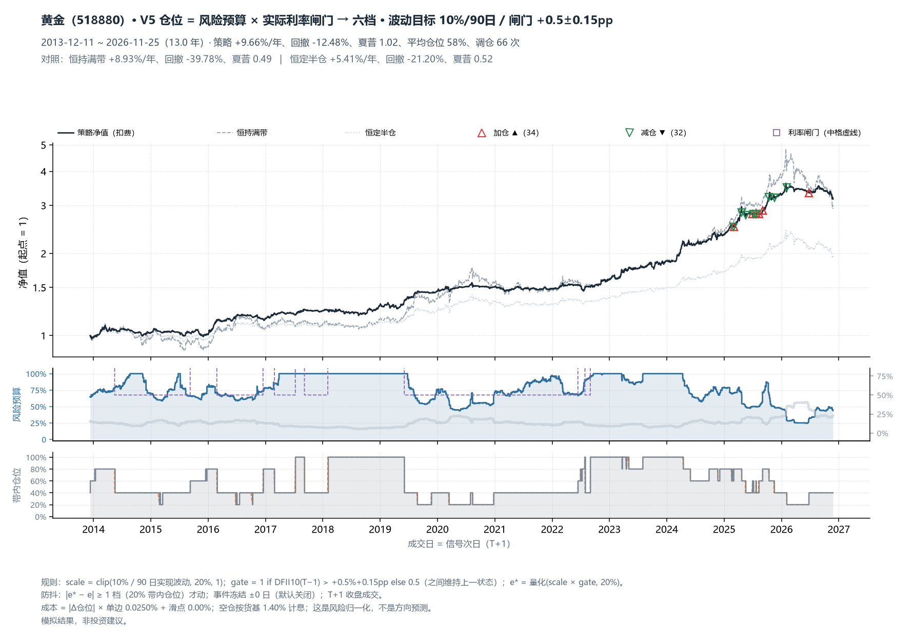

# V5.1 黄金仓位 · 每日推荐操作（2026-11-18）

> 标的：**场内 `518880` 黄金ETF华安**（收盘 7.7080）· 信号/执行/回测同一只 ETF · 目标带 10pp（1.0 = 满带 = 10pp）
> 决策在 T 日盘后、**T+1 收盘成交**；「今日动作」= 明天要下的单。数据截止：**价格 2026-11-18 / 实际利率 2026-11-16**（T 日只用 ≤T−1）。

## 今日操作一览

| 项 | 读数 |
|---|---|
| 实现波动（120 日） | **22.7%**（目标 10%，下限 20%） |
| 风险预算 scale | **0.44** = clip(10% / 22.7%, 20%, 1) |
| 实际利率水平 | **+2.92%**（2026-11-16；阈值 +0.5% ±0.15pp 死区） |
| 利率闸门 gate | **1.00**（满额预算） |
| 目标档 e* | **40%** 带 = 4.0pp / 10pp |
| 当前档 e | **40%** 带 = 4.0pp |
| 推荐动作 | **持有**（不动作） |
| 数据截止日 | 价格 2026-11-18 · DFII10 2026-11-16 |

**依据**：120 日实现波动 22.7%（目标 10%）→ 风险预算 0.44；DFII10 +2.92%（2026-11-16）高于 +0.5% → 闸门 1.00（死区 ±0.15pp）。

## 一、规则读数

- 风险预算：120 日已实现波动 **22.7%**，目标 10% → `scale = clip(10% / 22.7%, 20%, 1) = 0.44`。波动越高、能承担的风险越小 —— 这是「风险归一化」，不是方向判断。
- 利率闸门：DFII10 水平 **+2.92%**（2026-11-16，T−1 口径）。高于 +0.5%+0.15pp 才开闸；当前 **1.00**。
- 目标档 = 量化(0.44 × 1.00 = 0.44, 步长 20%) = **40%**。
- 滞后防抖：|e* − e| ≥ 1 档（20% 仓位 = 2.0pp 带）才动作，当前差 0.0pp → 不触发。

## 二、不计分项（只作提示，永不改变仓位数字）

- 宏观环境格：DXY 103.8 × CPI +4.08%（2026-11）→ 格子 **102.5~105 × 4~5**（历史 n=2、1 月胜率 50%、均值 +0.10%）
- 未维护（`data/_gold_hints.json` 不存在）：FedWatch / 央行购金 / 内外价差 三项缺输入。
- 资金流提示：份额最近 5 日净申购 2/5 日、累计 -2.67 亿元（2026-11-17；全史口径，仅提示）；主力净流入最近 5 日 1/5 日为正、最后一日 +1.29 亿（2026-11-17；仅 120 天，仅提示）

> 这些项与本次调仓方向冲突时只标注「观察，谨慎」，**绝不改变目标档数字**。
> 为什么资金流不进仓位：上交所份额全史已补齐并实测 —— 顺势口径显著恶化回撤、逆势只修回撤不增收益，两个方向都跑输恒定半仓。详见 `research/flow_source/_probe_flow.md`。
> 为什么美元/通胀格子不进仓位：DXY 与实际利率的信息高度重叠（已在闸门里），而月度格子的样本量不足以驱动仓位 —— 接进公式后年化/回撤/夏普均无改善。详见 `research/dxy_cpi/_probe_dxy_cpi.md`。

## 三、净值与操作点

## 四、一句话

波动 23%、预算 0.44、闸门 1.00 → 目标 40%，与当前 40% 相差不到一档，**今天不动**。

> 回测口径：2014-01-23 ~ 2026-11-18（12.8 年），单边 0.0250%，空仓计货基 1.40%；同期买入持有年化相近、回撤约为其三倍，取舍见 `backtest/_v5_gold_score_bt.md` §0。
> 模拟结果，非投资建议。
