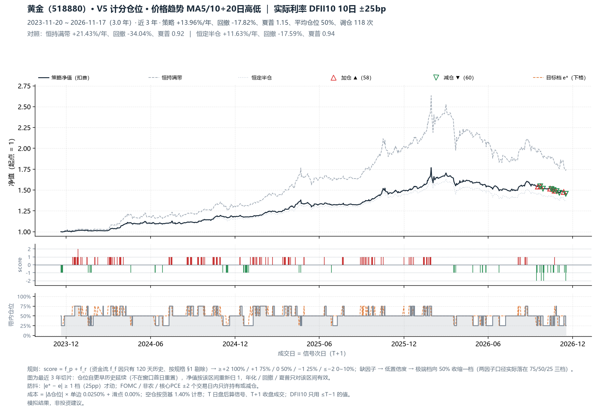

# V5 黄金计分仓位 · 每日推荐操作（2026-11-17）

> 标的：**场内 `518880` 黄金ETF华安**（收盘 7.9000）· 信号/执行/回测同一只 ETF · 目标带 10pp（1.0 = 满带 = 10pp）
> 决策在 T 日盘后、**T+1 收盘成交**；「今日动作」= 明天要下的单。数据截止：**价格 2026-11-17 / 实际利率 2026-11-16**（T 日只用 ≤T−1）。

## 今日操作一览

| 项 | 读数 |
|---|---|
| score | **-1**（区间 −3…+3；两因子口径 −2…+2） |
| 因子符号 | f_p 价格趋势 **0** · f_r 实际利率 **-1** · f_f 资金流 **剔除**（全史份额已复核，仍是负贡献 → 见回测 §8.2） |
| 目标档 e* | **25%** 带 = 2.5pp / 10pp |
| 当前档 e | **25%** 带 = 2.5pp |
| 推荐动作 | **持有**（不动作） |
| 置信度 | **低**（缺 f_f 已降一档） |
| 数据截止日 | 价格 2026-11-17 · DFII10 2026-11-16 |

**依据**：价格趋势不满足双向确认；DFII10 10 日变化 +32bp（利空）。

## 一、规则读数

- 价格：收盘 7.9000，MA5 / MA10 与 20 日高/低 的双向确认 → **f_p = 0**（只有「强且贴边」才给分，中间地带一律 0）。
- 实际利率：DFII10 的 10 日变化 **+32bp**（阈值 ±25bp）→ **f_r = -1**；用的是 2026-11-16 的值（T−1 口径，规格 §6.1）。
- 目标档映射：-1 分 → 25%（缺因子 → 低置信度 → 极端档向 50% 收缩一档）。
- 滞后防抖：|e* − e| ≥ 1 档（25pp）才动作，当前差 0pp → 不触发。

## 二、不计分项（只作提示，永不改变仓位数字）

- 未维护（`data/_gold_hints.json` 不存在）：FedWatch / 央行购金 / 内外价差 三项缺输入。
- 资金流提示：份额最近 5 日净申购 2/5 日、累计 -2.74 亿元（2026-11-17；全史口径，仅提示）；主力净流入最近 5 日 1/5 日为正、最后一日 +1.29 亿（2026-11-17；仅 120 天，仅提示）

> 规格 §2：这些项与 score 冲突时只在报告标注「观察，谨慎」并降一档置信度，**绝不改变目标档数字**。
> 资金流为何不计分：上交所份额全史已补齐（2013-07 起 3234 日 0 缺失）并实测，顺势口径把回撤从 -17.8% 恶化到 -22.8%、逆势只修回撤不增收益 —— 两个方向都跑输「恒定半仓」。详见 `backtest/_v5_gold_score_bt.md` §8.2 与 `research/flow_source/_probe_flow.md`。

## 三、净值与操作点

## 四、一句话

score -1、目标 25% 与当前 25% 相差不到一档，**今天不动**。

> 回测口径：2013-07-29 ~ 2026-11-17（13.3 年），单边 0.0250%，空仓计货基 1.40%；本口径与「恒定半仓」几乎等价，取舍见 `backtest/_v5_gold_score_bt.md` §0。
> 模拟结果，非投资建议。
