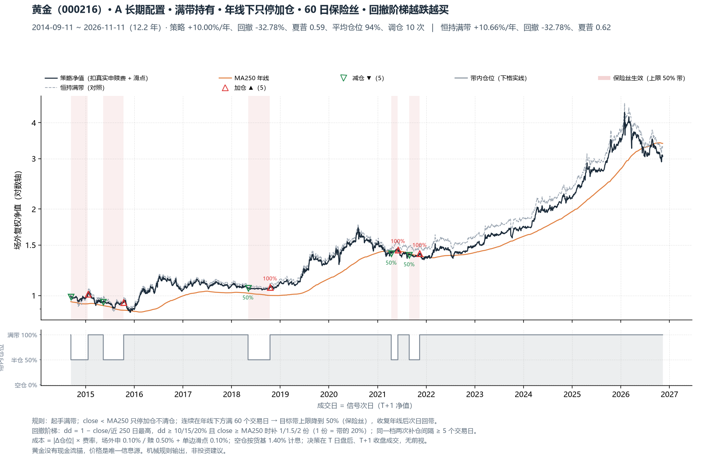
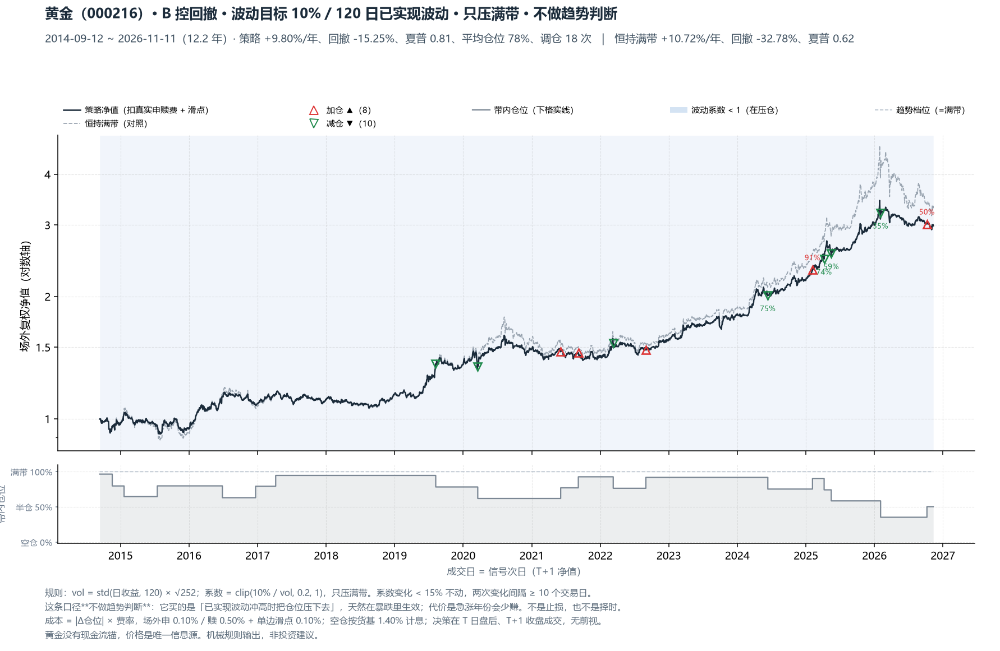
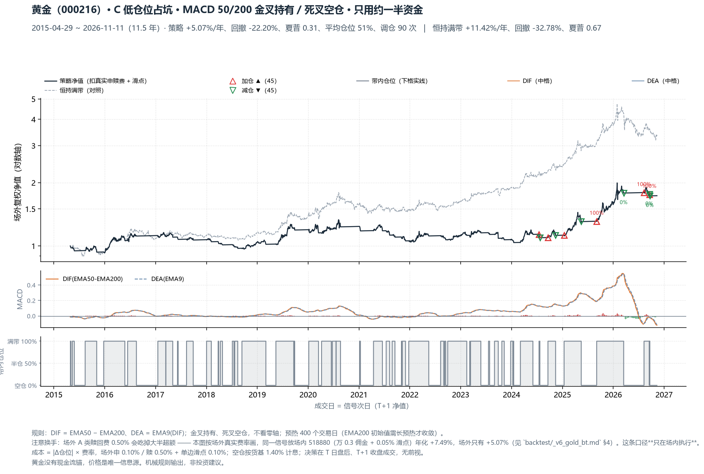

# V6 黄金三口径 · 每日推荐操作（2026-11-11）

> 标的只有一个：**黄金**。场外执行 `000216`（净值 3.0155，2026-11-11）· 场内信号 `518880`（收盘 8.1010，2026-11-12）· 目标带 10pp（1.0 = 满带 = 10pp）
> 决策在 T 日盘后，**T+1 收盘成交**；「今日动作」= 明天要下的单。

## 今日操作一览

| 口径 | 当前仓位 | 今日动作 | 触发条件 / 依据 |
|---|---:|---|---|
| **A 长期配置** | 100% 带 = 10.0pp | **无** | 年线下方第 47 日（47/60），满 60 日降为 50% 带 |
| **B 控回撤** | 50% 带 = 5.0pp | **无** | 已实现波动 20.8% → 系数 0.50 |
| **C 低仓位占坑** | 0% | **无** | MACD 50/200 死叉空仓 |

> ⚠ 三条口径是**同一笔钱的三种拿法，互斥** —— 选一条执行，**不要相加**。
> 差别在「你要黄金干什么」：长期配置不想管（A）/ 压组合波动（B）/ 必须有明确进出信号（C）。

## 一、A 长期配置（满带 + 60 日保险丝 + 回撤阶梯）

- 收盘 3.0155 / 年线(MA250) 3.3896 → **-11.04%**（年线下方第 47 日）；距前高回撤 **29.9%**。
- 当前档位 **100% 带 = 10.0pp**；保险丝未生效（门槛：连续 60 日收在年线下方）。
- 保险丝进度 47/60 日；回撤阶梯下一档 已满带，阶梯暂时没有空位，剩余额度 0% 带（0.0pp）。
- **今日动作：无**
- 最近三笔：2021-06-02 加仓 50%→100% / 2021-08-26 减仓 100%→50% / 2021-11-12 加仓 50%→100%

## 二、B 控回撤（波动目标 10%/120 日，不做趋势判断）

- 120 日已实现波动 **20.8%** vs 目标 10% → 波动系数 **0.50**（<1 才压仓）。
- 当前仓位 **50% 带 = 5.0pp**。
- **今日动作：无**
- 最近三笔：2025-05-16 减仓 74%→59% / 2026-02-03 减仓 59%→35% / 2026-10-08 加仓 35%→50%

## 三、C 低仓位占坑（MACD 50/200 金叉持有）

- 场内信号：DIF -0.3374 / DEA -0.3101 → **死叉（空仓）**，当前仓位 0%。
- 最近一次信号：2026-09-17 减仓 100%→0%
- 场外同口径对照：死叉，仓位 0%（DIF -0.1194 / DEA -0.1102）
- **今日动作：无**
- ⚠ 换手提醒：这条口径每年约 7~8 次调仓，**只在场内低佣金账户执行**；场外 A 类（赎 0.50%）累计成本 36pp、年化只剩 +5.07%，场内是 +7.49%（MACD 50/200 口径，见 `backtest/_v6_gold_bt.md` §4）。

## 四、一句话

A 口径：年线下方第 47 日，只停加仓不清仓；满 60 日会自动降到 50% 带。 B 口径当前 50% 带（已实现波动 21%），C 口径空仓。

> 模拟结果，非投资建议；三口径的取舍见 `backtest/_v6_gold_bt.md` §0。
