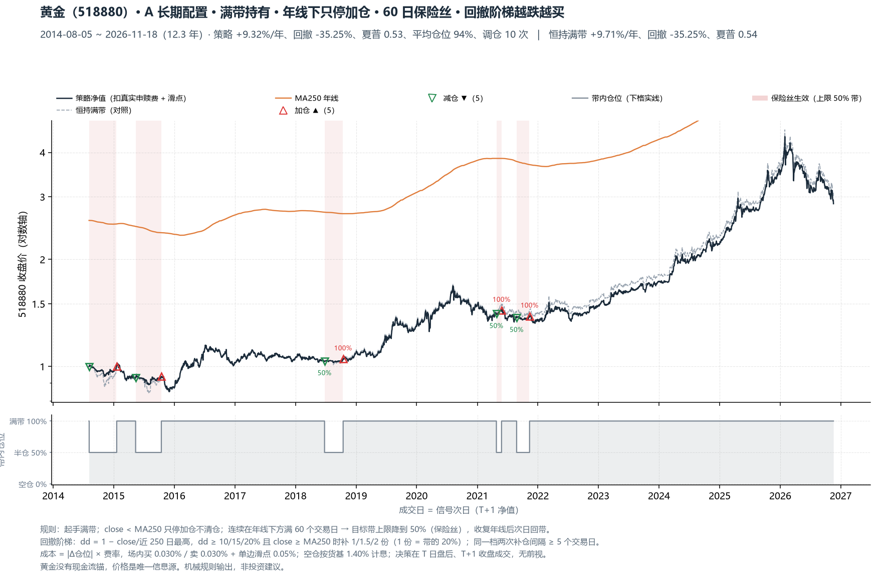
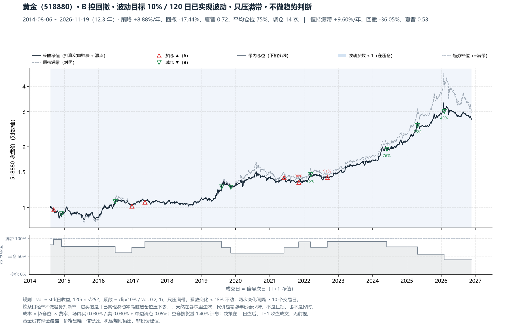
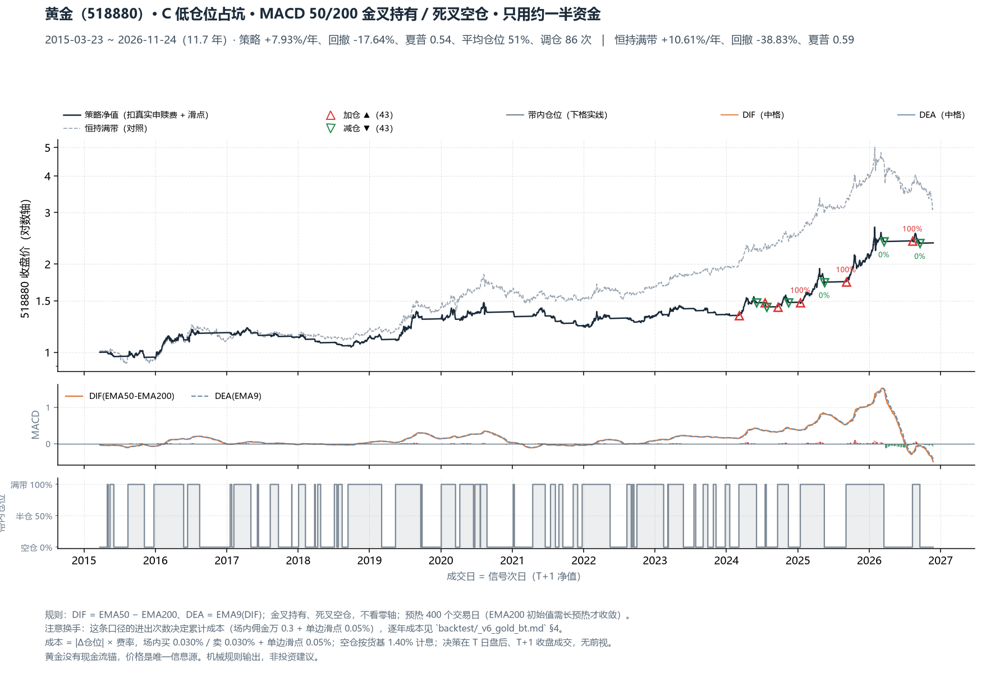

# V6 黄金三口径 · 每日推荐操作（2026-11-20）

> 标的只有一个：**场内 `518880` 黄金ETF华安**（收盘 7.2820，2026-11-20）· 价格 / 信号 / 执行都是这一只 ETF · 目标带 10pp（1.0 = 满带 = 10pp）
> 决策在 T 日盘后，**T+1 收盘成交**；「今日动作」= 明天要下的单。

## 今日操作一览

| 口径 | 当前仓位 | 今日动作 | 触发条件 / 依据 |
|---|---:|---|---|
| **A 长期配置** | 100% 带 = 10.0pp | **无** | 年线下方第 54 日（54/60），满 60 日降为 50% 带 |
| **B 控回撤** | 40% 带 = 4.0pp | **无** | 已实现波动 23.5% → 系数 0.40 |
| **C 低仓位占坑** | 0% | **无** | MACD 50/200 死叉空仓 |

> ⚠ 三条口径是**同一笔钱的三种拿法，互斥** —— 选一条执行，**不要相加**。
> 差别在「你要黄金干什么」：长期配置不想管（A）/ 压组合波动（B）/ 必须有明确进出信号（C）。

## 一、A 长期配置（满带 + 60 日保险丝 + 回撤阶梯）

- 收盘 7.2820 / 年线(MA250) 9.2913 → **-21.63%**（年线下方第 54 日）；距前高回撤 **38.8%**。
- 当前档位 **100% 带 = 10.0pp**；保险丝未生效（门槛：连续 60 日收在年线下方）。
- 保险丝进度 54/60 日；回撤阶梯下一档 已满带，阶梯暂时没有空位，剩余额度 0% 带（0.0pp）。
- **今日动作：无**
- 最近三笔：2021-05-27 加仓 50%→100% / 2021-08-26 减仓 100%→50% / 2021-11-12 加仓 50%→100%

## 二、B 控回撤（波动目标 10%/120 日，不做趋势判断）

- 120 日已实现波动 **23.5%** vs 目标 10% → 波动系数 **0.40**（<1 才压仓）。
- 当前仓位 **40% 带 = 4.0pp**。
- **今日动作：无**
- 最近三笔：2024-05-31 减仓 91%→76% / 2025-04-24 减仓 76%→55% / 2026-02-02 减仓 55%→40%

## 三、C 低仓位占坑（MACD 50/200 金叉持有）

- 信号：DIF -0.4453 / DEA -0.3799 → **死叉（空仓）**，当前仓位 0%。
- 最近一次信号：2026-09-17 减仓 100%→0%
- **今日动作：无**
- ⚠ 换手提醒：这条口径每年约 1~2 个往返（MACD 50/200），按场内佣金 0.030% + 单边滑点 0.05% 计成本，累计成本见 `backtest/_v6_gold_bt.md` §4。

## 四、一句话

A 口径：年线下方第 54 日，只停加仓不清仓；满 60 日会自动降到 50% 带。 B 口径当前 40% 带（已实现波动 24%），C 口径空仓。

> 模拟结果，非投资建议；三口径的取舍见 `backtest/_v6_gold_bt.md` §0。
