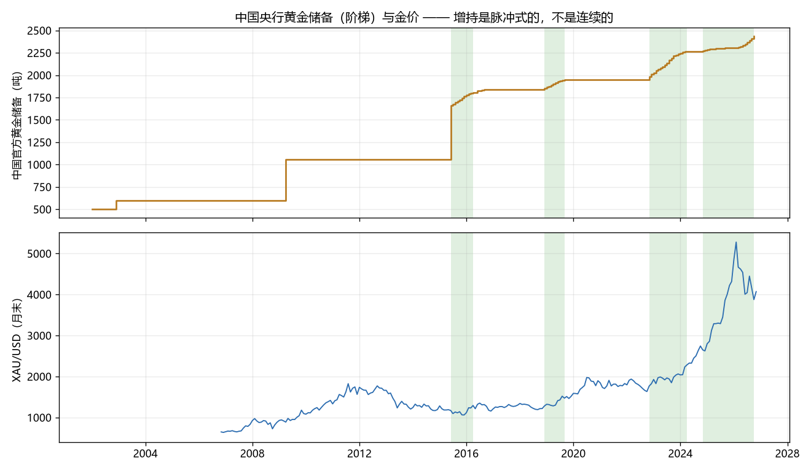
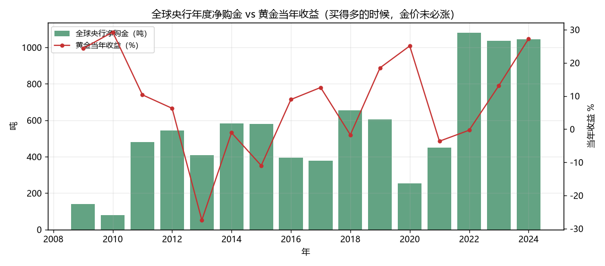
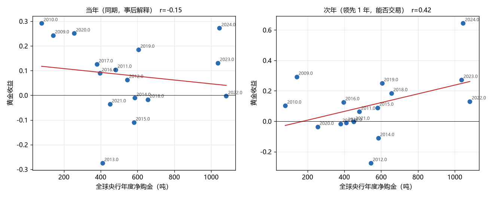

# V6 黄金 · 央行购金：持续性与力度变化

> 由 `_gold_centralbank.py` 生成。检验用户追问的「各地央行是否持续购金、购金力度变化」。
> 数据：中国官方黄金储备 **月度**（akshare，2002-01-01 ~ 2026-10-01，298 条）；全球央行净购金 **年度**（WGC Gold Demand Trends 口径，脚本常量 `CB_ANNUAL`，2009-2024，**2025 及之后未录入**）。
> 换算：1 吨 = 32,150.7 金衡盎司。当前中国储备 **2435 吨**（7830 万盎司）。

## 1. 一句话结论

1. **「持续购金」是个错觉 —— 央行买金是脉冲式的，不是连续的。** 2015 年以来 5 段增持期合计 68 个月、3 段暂停期合计 68 个月，**平均每段增持只持续 13.6 个月，每段暂停 22.7 个月**。最长的暂停从「2019-10-01」起，连续 37 个月一动不动。
2. **全球口径看，央行买得最多的时候金价在跌。** 2013-2015 年央行年均净购金 524 吨，同期金价三年累计 **-36.1%**；而 2022-2024 年买入量翻倍到 1055 吨，金价才真正起来。**同期相关 r=-0.15（买得多反而跌），领先一年 r=0.42 —— 但剔掉最后一年后只剩 0.17**（见 §4）。可见「买了就涨」和「买了明年涨」都站不住。
3. **「力度变化」同样没有信息。** 中国 12 个月滚动购金量的半年加速度 vs 未来 6~12 个月金价收益，r=-0.04（n=130，2015 年后）—— 基本是零。按 12 个月滚动购金量分三档，后续表现分别是 +3.0% / +25.1% / +9.7%，**不是单调的**：买得最猛的那一档并不比暂停期好。
4. **按年度购金量做择时，年化略输买入持有，但回撤极低。** 最好的阈值 600 吨年化 +8.2%、最大回撤 0.0%、平均仓位 31%；买入持有 +8.9% / -36.1%。**看着像「低回撤版」——但这不是择时能力，是 16 年里只持有了 5 年，恰好躲掉了 2013 和 2015 两个下跌年。**样本外无法验证。

## 2. 中国央行：增持期 / 暂停期全景

| type | start | end | months | chg_tonnes | start_tonnes | end_tonnes |
|---|---|---|---|---|---|---|
| 暂停 | 2002-01-01 | 2002-11-01 | 11 | +0 | 500 | 500 |
| 暂停 | 2003-01-01 | 2009-03-01 | 75 | +0 | 600 | 600 |
| 暂停 | 2009-05-01 | 2015-05-01 | 73 | +0 | 1054 | 1054 |
| 增持 | 2015-06-01 | 2016-04-01 | 11 | +754 | 1054 | 1808 |
| 增持 | 2016-06-01 | 2016-10-01 | 5 | +34 | 1808 | 1843 |
| 暂停 | 2016-11-01 | 2018-11-01 | 25 | +0 | 1843 | 1843 |
| 增持 | 2018-12-01 | 2019-09-01 | 10 | +106 | 1843 | 1948 |
| 暂停 | 2019-10-01 | 2022-10-01 | 37 | +0 | 1948 | 1948 |
| 增持 | 2022-11-01 | 2024-04-01 | 18 | +316 | 1948 | 2264 |
| 暂停 | 2024-05-01 | 2024-10-01 | 6 | +0 | 2264 | 2264 |
| 增持 | 2024-11-01 | 2026-10-01 | 24 | +171 | 2264 | 2435 |

> 判定口径：连续 ≥6 个月储备不变 = 「暂停」，连续 ≥3 个月增加 = 「增持期」。中国央行只在增持时公布变化，所以「不变」就等于「没买」。
>
> ⚠ **2015 年之前的段不可作数**：那时中国不按月公布，储备是长期不变后一次跳增（2001-2003 的 500→600 吨就是这么来的），下面 §1 的统计只用 2015 年后的段。

## 3. 转折点：「重启增持」和「暂停增持」之后金价怎么走

事件月**之前**的月末收盘为基准，看之后 1/3/6/12 个月。

| date | kind | px | 1月 | 3月 | 6月 | 12月 |
|---|---|---|---|---|---|---|
| 2015-06-01 | 重启增持 | 1190 | -1.5% | -4.7% | -10.6% | +2.1% |
| 2016-05-01 | 暂停增持 | 1294 | -6.1% | +4.4% | -1.5% | -2.1% |
| 2016-06-01 | 重启增持 | 1215 | +8.8% | +7.7% | -3.2% | +4.3% |
| 2016-11-01 | 暂停增持 | 1274 | -7.7% | -4.9% | -0.6% | -0.4% |
| 2018-12-01 | 重启增持 | 1218 | +5.1% | +8.0% | +6.9% | +20.1% |
| 2019-10-01 | 暂停增持 | 1472 | +2.7% | +3.0% | +7.1% | +28.1% |
| 2022-11-01 | 重启增持 | 1633 | +8.3% | +18.1% | +21.8% | +21.5% |
| 2024-05-01 | 暂停增持 | 2286 | +1.8% | +7.0% | +20.0% | +43.8% |
| 2024-11-01 | 重启增持 | 2744 | -3.4% | +2.1% | +19.8% | +45.9% |

- **重启增持后 12 个月**：均值 +18.8%，5/5 次为正
- **暂停增持后 12 个月**：均值 +17.4%，2/4 次为正

> 两组**几乎没差别**（重启后 12 个月均值 +18.8% vs 暂停后 +17.4%），说明「转折」本身不携带方向信息 —— 暂停增持不是利空（2024-05 暂停后 12 个月还涨了 +43.8%）。另外要注意**反向因果**：储备是按美元市价折算的，金价涨了储备价值自然涨，而且央行也确实倾向在上涨中增持，所以「重启增持」更像**确认信号**而非**领先信号**。

## 4. 全球口径：年度购金 vs 金价

| year | cb_tons | gold_ret | gold_ret_next |
|---|---|---|---|
| 2009 | 141 | +24.3% | +29.3% |
| 2010 | 79 | +29.3% | +10.3% |
| 2011 | 481 | +10.3% | +6.3% |
| 2012 | 544 | +6.3% | -27.5% |
| 2013 | 409 | -27.5% | -1.1% |
| 2014 | 584 | -1.1% | -11.0% |
| 2015 | 580 | -11.0% | +8.9% |
| 2016 | 395 | +8.9% | +12.6% |
| 2017 | 379 | +12.6% | -1.7% |
| 2018 | 656 | -1.7% | +18.5% |
| 2019 | 605 | +18.5% | +25.1% |
| 2020 | 255 | +25.1% | -3.6% |
| 2021 | 450 | -3.6% | -0.3% |
| 2022 | 1082 | -0.3% | +13.1% |
| 2023 | 1037 | +13.1% | +27.2% |
| 2024 | 1045 | +27.2% | +64.6% |

**相关系数**：同期 r=-0.15（n=16）；购金 → 次年收益 r=0.42（n=16）。

> ⚠ **那个 r=0.42 是被单点撑起来的。** 剔掉最后一个配对（2024 购金 → 2025 收益 +64.6%）后，r 掉到 **0.17**（n=15）。也就是说「央行买得多 → 明年金价涨」这个规律，本质上只有 2022-2025 这一轮牛市在支撑 —— 而那一轮本身就是央行购金与金价互相强化的结果，拿它预测下一轮等于假设「上一轮会重复」。

## 5. 力度变化（中国月度，n=142）

12 个月滚动购金量（吨）分三档，看**同期** 12 个月金价收益 —— 注意是同期，用来判断「力度」到底反映了什么，不是预测：

| 力度 | n | mean_buy | mean_ret | win |
|---|---|---|---|---|
| 力度弱 | 47 | 0 吨 | +3.0% | 49% |
| 力度中 | 47 | 40 吨 | +25.1% | 79% |
| 力度强 | 48 | 283 吨 | +9.7% | 79% |

同期相关 r=-0.24（n=142）；**力度加速度 → 未来 6-12 个月收益** r=-0.04（n=130）。

## 6. 能不能变成钱：年度购金阈值择时（t 年末确认 → t+1 年持有）

| thr | years | expo | ann | mdd | vol | win |
|---|---|---|---|---|---|---|
| ≥400 吨 | 16 | 69% | +6.1% | -36.1% | 20% | 64% |
| ≥500 吨 | 16 | 50% | +5.8% | -35.4% | 20% | 75% |
| ≥600 吨 | 16 | 31% | +8.2% | 0.0% | 18% | 100% |
| ≥800 吨 | 16 | 19% | +5.5% | 0.0% | 17% | 100% |
| 买入持有 | 16 | 100% | +8.9% | -36.1% | 21% | 62% |

> 注意样本只有 **16 个年度**，且 2022-2025 是同一轮牛市 —— 任何「有用」的结论都是这四年撑出来的。阈值越低，越接近买入持有，也就越说明**这个指标没有提供额外的择时信息**。

## 7. 局限（这一节尤其重要）

1. **全球口径是人工录入的年度常量**（`CB_ANNUAL`），不是我抓的。来源是 WGC《Gold Demand Trends》年度央行净购金，**使用前请核对**；2025 及之后留空，因为该口径需等年报。这决定了 §4/§6 的所有数字都只能当参考。
2. **中国月度储备是「万盎司」而非吨**，且央行只在增持时更新，所以「暂停」段内无法区分「不想买」和「没公布」。
3. **同期相关是负的（r=-0.15），但这不代表「买得多所以跌」**。更可能的两条机制：① 央行**逆势买入**（金价跌、占比被动下降时才补）；② 全球购金量本身就是金价的**滞后反应** —— 2022-2024 买得多，是因为金价涨了之后各国被动补配。两条都说明「购金量 → 金价」这个方向不成立。
4. **样本极大受限**：全球 16 个年度、中国 5 段增持期、转折点 9 个。任何 p 值都不可信，本报告只做形态判断。
5. 仓库里 `strategies/vol_legs/rule.py` 的 `wgrc_fuse_quarters=2`（连续 2 季购金为负→降档）一直是 `null` 未维护 —— 本报告第一次给它提供了可回测的历史序列（`_cn_gold_reserves.csv`），但**建议仍然不要打开**：中国的增持是脉冲式的，按季度判定会频繁误触发。
