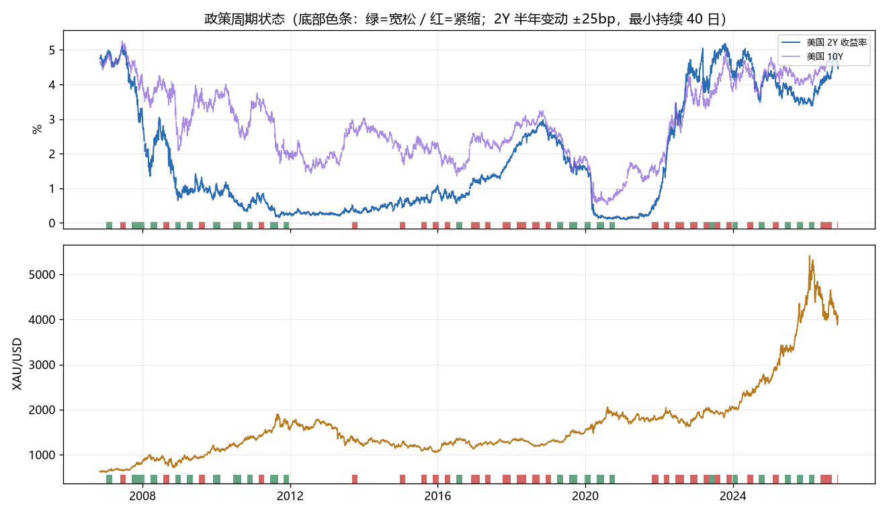
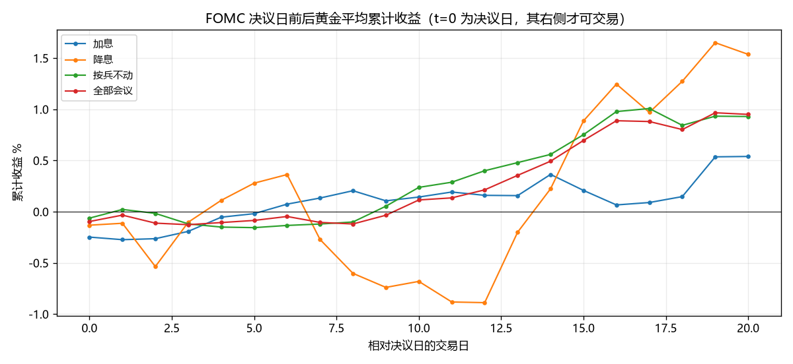
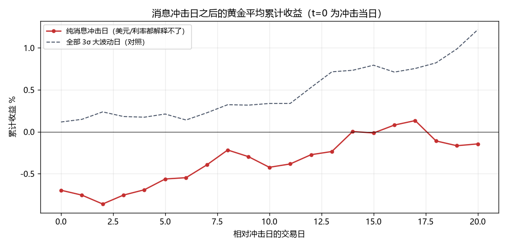

# V6 黄金 · 事件驱动：政策周期 / FOMC / 地缘冲突 / 消息冲击

> 由 `_gold_cycles.py` 生成。承接 `_gold_macro.md` 的「事件驱动」那一节，把用户提到的**加息降息周期、战争预警**这类事件单独拎出来检验。
> 样本：XAU/USD 日频 **2006-11-07 ~ 2026-11-06**；政策利率用美国 **2Y 国债收益率**（市场定价的政策利率，日频完整），FOMC 日历 150 次会议。

## 1. 一句话结论

1. **「降息周期买黄金」在数据上不成立 —— 但「为什么不成立」比结论本身更值得看。** 第一版（状态不加最小持续期）：宽松 +29.5% / 平台 +4.6% / 紧缩 -6.5%，差 36pp，看起来完美支持这个直觉。加上 40 日最小持续期（更接近真实周期）后：紧缩 +13.1% / 平台 +6.1% / 宽松 +7.2% —— **差异基本消失，甚至紧缩期最好**。
2. **一个参数就让 36pp 的差距归零，说明这个变量根本不稳。** 不加约束时 2Y 的半年变动在阈值附近来回翻，20 年切换 **421 次**，把黄金在 2008-2011 和 2020 的暴涨随机切进了「宽松」标签 —— 那是**采样偏差**，不是因果。加上约束后切换降到 **92 次**。这种「换个实现就翻」的脆弱性，比任何 p 值都更能说明「政策周期不能用来给黄金择时」。
3. **FOMC 决议日只放大波动，不给方向 —— 这条最硬。** 决议日 |日收益| 均值 1.16%，全样本 0.78%，Welch **t=3.91**（150 次会议），放大约 1.5 倍。而 T+1 起的方向漂移，加息/降息/按兵不动三组**没有一组**过 2 倍标准误。
4. **「消息驱动」的冲击，之后既没有延续也没有反转 —— 就是没有信息。** 宏观解释不了的大波动（残差 2.5σ）共 135 天（占 2.61%），T+20 平均 +0.5%（t=0.87），**低于**黄金的无条件 20 日均值 +0.7%。也就是说：突发消息砸出来或拉出来的幅度，5~20 天内被市场完全消化，方向不可预测，反着做也不成立。
5. **战争类事件是唯一「当天有反应」的：T+0 平均 +1.1%（t=2.29，7/10 次上涨），但 T+1 就归零（-0.1%）、T+5 仍是 -0.1%。** 这是「谣言时买入、新闻时卖出」的量化版。问题在于**当天买不到**（T+1 才成交），等你能买时超额已经消失。

## 2. 政策周期：一个参数就让结论翻转

状态判定：美国 2Y 收益率 **120 个交易日（约半年）变动 ≥ +25bp → 紧缩**，≤ -25bp → 宽松，其余为平台。用 2Y 而非联邦基金利率，是因为它能日频、连续地反映市场对政策的定价；真正的政策利率是阶梯函数，半年内经常一动不动的会议占七成。

### 2.1 口径 A：不施加最小持续期（切换 421 次）

| state | days | share | ann | vol | win | mean_bp |
|---|---|---|---|---|---|---|
| 紧缩 | 1229 | 24% | -6.5% | 15% | 51% | -2.2 |
| 平台 | 2550 | 49% | +4.6% | 17% | 52% | +2.4 |
| 宽松 | 1388 | 27% | +29.5% | 21% | 57% | +11.1 |
| 全期 | 5167 | 100% | +7.9% | 18% | 53% | +3.6 |

### 2.2 口径 B：施加 40 日最小持续期（切换 92 次）—— 本文采用

| state | days | share | ann | vol | win | mean_bp |
|---|---|---|---|---|---|---|
| 紧缩 | 1182 | 23% | +13.1% | 16% | 53% | +5.4 |
| 平台 | 2944 | 57% | +6.1% | 17% | 52% | +2.9 |
| 宽松 | 1041 | 20% | +7.2% | 21% | 55% | +3.6 |
| 全期 | 5167 | 100% | +7.9% | 18% | 53% | +3.6 |

`share` = 该状态占样本天数；`mean_bp` = 日均收益（基点）。两个口径只差「状态最短维持多久」，结果从「宽松碾压紧缩」变成「紧缩反而最好」—— **这就是这类状态划分的真实可靠度。**

**状态切换的完整区间**（连续同状态 ≥60 个交易日的段落，`chg` 是区间内 2Y 的净变动）：

| state | start | end | days | from | to | chg |
|---|---|---|---|---|---|---|
| 宽松 | 2007-09-18 | 2008-01-18 | 86 | 4.00 | 2.36 | -1.64pp |
| 平台 | 2010-02-09 | 2010-06-16 | 92 | 0.84 | 0.75 | -0.09pp |
| 平台 | 2011-12-27 | 2013-09-04 | 441 | 0.30 | 0.46 | +0.16pp |
| 平台 | 2013-10-31 | 2014-12-22 | 298 | 0.31 | 0.71 | +0.40pp |
| 平台 | 2015-02-17 | 2015-07-21 | 111 | 0.70 | 0.71 | +0.01pp |
| 平台 | 2016-08-30 | 2016-11-24 | 63 | 0.80 | 1.12 | +0.32pp |
| 紧缩 | 2016-11-25 | 2017-02-17 | 60 | 1.12 | 1.21 | +0.09pp |
| 平台 | 2017-06-12 | 2017-09-29 | 80 | 1.35 | 1.47 | +0.12pp |
| 紧缩 | 2017-10-02 | 2017-12-22 | 60 | 1.49 | 1.91 | +0.42pp |
| 紧缩 | 2018-02-20 | 2018-05-25 | 69 | 2.25 | 2.48 | +0.23pp |
| 宽松 | 2019-07-22 | 2019-10-11 | 60 | 1.80 | 1.63 | -0.17pp |
| 平台 | 2020-10-23 | 2021-10-15 | 254 | 0.18 | 0.41 | +0.23pp |
| 紧缩 | 2022-06-10 | 2022-09-02 | 61 | 3.06 | 3.40 | +0.34pp |
| 平台 | 2024-02-22 | 2024-05-23 | 65 | 4.69 | 4.91 | +0.22pp |
| 紧缩 | 2026-05-19 | 2026-09-04 | 79 | 4.13 | 4.37 | +0.24pp |

> 能看出两件事：① 状态段长度从几十到四百多个交易日不等，而黄金在同一个状态内可以正负反转多次 —— 颗粒度太粗；② **不加最小持续期时，2Y 的半年变动在阈值附近会来回翻**：20 年切换 421 次，加上 40 日约束后降到 92 次。即便如此，这个状态变量仍然是「慢半拍」的 —— 等它确认，行情已经走完一半，这就是 §6 择时失败的直接原因。

## 3. FOMC 决议日：显著的是波动，不是方向

| act | n | t0_mean | t0_abs | 次日_mean | 次日_t | 5日_mean | 5日_t | 20日_mean | 20日_t |
|---|---|---|---|---|---|---|---|---|---|
| 加息 | 20 | -0.2% | 1.11% | -0.0% | -0.08 | +0.2% | 0.44 | +0.8% | 0.78 |
| 降息 | 18 | -0.1% | 1.41% | +0.0% | 0.04 | +0.4% | 0.51 | +1.7% | 0.93 |
| 按兵不动 | 112 | -0.1% | 1.13% | +0.1% | 0.80 | -0.1% | -0.39 | +1.0% | 2.21 |

**波动放大检验**：决议日 |日收益| 均值 **1.16%**，全样本 **0.78%**，Welch t = **3.91**（n=150 次会议），放大约 **1.5 倍**，非常显著。

> ⚠ **读 T+20 那一列之前先扣掉 beta。** 黄金本身长期上行，任意取 20 个交易日，无条件均值就有 **+0.7%**。所以「降息后 T+20 +1.7%」看着不错，相对基准只多 +0.9%，且 t=0.93（n=18）—— 不显著。真正超过 2 倍标准误的只有「按兵不动」组的 +1.0%，而它本质上就是「21 年里大部分时间的平均表现」，不是事件效应。

> 这是本次研究里**最稳固的一个结论**：政策事件确定性地放大波动，但方向是随机的。对做方向的人没用，对做波动/仓位的人有用 —— 「决议周别满仓、别用窄止损」是可执行的，而「降息就买黄金」不是。

## 4. 消息冲击日：突发的大涨大跌，之后往哪走

定义用**回归残差**而不是「三个条件同时满足」：先估 `r_gold = a + b₁·Δln(DXY) + b₂·Δy10 + ε`，取 |ε| > 2.5·σ(ε) 的日子。拟合结果 R² = **0.177**（b₁=-0.90、b₂=-0.027/pp），即美元和 10Y 只能解释黄金日波动的 **18%** —— 剩下 82% 归给「消息面」。

> 早前版本用「|r|>3σ 且 |ΔDXY|<1σ 且 |Δy10|<1σ」，结果**一天都选不出来** —— 这本身就是结论：黄金 3σ 级别的日波动，几乎全部伴随美元或利率的大动，「纯消息驱动」在日频上比想象中稀有。改用残差口径才拿到足够样本。

| 组 | n | 占比 | T+1 | T+1_t | T+5 | T+5_t | T+20 | T+20_t |
|---|---|---|---|---|---|---|---|---|
| 纯消息冲击 | 135 | 3% | -0.1% | -0.33 | +0.1% | 0.42 | +0.5% | 0.87 |
| 宏观驱动的大波动(≥2σ) | 207 | 4% | +0.0% | 0.46 | +0.1% | 0.47 | +1.1% | 3.56 |

**最近的纯消息冲击日**（最近 15 个；`r_gold` 是黄金当日涨跌，`r_dxy`/`dy10` 用来验证确实不是宏观驱动，`resid` 是回归残差）：

| date | r_gold | r_dxy | dy10 | resid |
|---|---|---|---|---|
| 2026-11-04 | +3.3% | -0.3% | -0.05pp | +2.8% |
| 2026-10-30 | -3.7% | +0.1% | -0.04pp | -3.7% |
| 2026-10-22 | -2.9% | -0.1% | -0.17pp | -3.4% |
| 2026-09-28 | -4.1% | +0.2% | +0.07pp | -3.8% |
| 2026-08-28 | -3.3% | +0.6% | +0.06pp | -2.6% |
| 2026-08-19 | +4.3% | -0.9% | -0.06pp | +3.3% |
| 2026-08-05 | +4.1% | -0.2% | +0.00pp | +3.9% |
| 2026-06-24 | -2.7% | +0.2% | -0.09pp | -2.8% |
| 2026-06-11 | +3.4% | -0.4% | -0.10pp | +2.7% |
| 2026-06-10 | -4.5% | +0.1% | +0.02pp | -4.4% |
| 2026-06-05 | -3.4% | +0.6% | +0.08pp | -2.6% |
| 2026-03-31 | +3.4% | -0.6% | -0.05pp | +2.7% |
| 2026-03-27 | +2.6% | +0.3% | +0.02pp | +2.9% |
| 2026-03-20 | -3.4% | +0.3% | +0.14pp | -2.7% |
| 2026-03-19 | -3.6% | -1.1% | -0.01pp | -4.6% |

> **两组的对照很干净**：纯消息组 135 天，T+20 = +0.5%；宏观驱动组 207 天，T+20 = +1.1%，后者看着 t=3.56 很显著，但黄金的无条件 20 日均值本身就是 +0.7% —— **超额只有 0.38pp，就是 beta，不是 alpha**。纯消息组连基准都不到。结论：消息冲击不能追，也不能反着做。

## 5. 地缘冲突：逐笔复盘（定性，样本太少）

T0 = 事件后第一个交易日。`t0` 是当日反应（无法交易），`t5`/`t20` 是从 T+1 起的累计。

| date | event | t0 | dxy0 | t1 | t5 | t20 |
|---|---|---|---|---|---|---|
| 2011-03-21 | 利比亚禁飞区军事干预 | +0.7% | -0.4% | +0.0% | -0.5% | +4.7% |
| 2014-03-18 | 克里米亚并入俄罗斯 | -0.8% | +0.0% | -2.0% | -3.3% | -4.0% |
| 2014-09-23 | 美军空袭叙利亚 ISIS | +0.8% | +0.0% | -0.6% | -1.3% | +2.0% |
| 2015-11-13 | 巴黎连环恐袭 | -0.2% | +0.4% | -0.1% | -0.5% | -0.8% |
| 2016-06-24 | 英国脱欧公投结果 | +4.6% | +2.3% | +0.7% | +2.0% | +0.5% |
| 2017-08-09 | 朝美「火与怒」危机 | +1.5% | -0.1% | +0.9% | +0.0% | +5.1% |
| 2020-01-03 | 苏莱曼尼被袭身亡 | +1.5% | +0.1% | +0.9% | +0.7% | +2.4% |
| 2022-02-24 | 俄乌冲突爆发 | -0.3% | +0.9% | -0.8% | +1.7% | +2.8% |
| 2023-10-09 | 哈马斯袭击以色列 | +1.6% | -0.0% | -0.1% | +3.1% | +6.1% |
| 2024-04-15 | 伊朗袭击以色列 | +1.6% | +0.2% | -0.0% | -2.4% | -2.0% |

| 窗口 | 均值 | 胜率 | t | n |
|---|---|---|---|---|
| T0 | +1.1% | 70% | 2.29 | 10 |
| T1 | -0.1% | 30% | -0.36 | 10 |
| T5 | -0.1% | 50% | -0.08 | 10 |
| T20 | +1.7% | 70% | 1.63 | 10 |

> **这个「当天涨、次日归零」的形态是本报告最值得记住的一条**：T0 平均 +1.1% 且 t=2.29，T+1 立刻变成 -0.1%（t=-0.36），T+5 仍是 -0.1%。地缘冲击的定价几乎全部发生在**你无法成交的那一天**。这就解释了为什么「战争预警」类消息在实战里难做：真正的升温期金价是缓慢抬升的，等到开战那天反而是最后一跳 —— **谣言时买入，新闻时卖出**。

> ⚠ **为什么这里不能当统计结论用**：10 个事件里有 2 对是同一轮周期（2014 克里米亚/ISIS、2023 以哈/2024 伊朗），独立样本不到 5 个。T0 的 t=2.29 是「10 个数、7 个同向」撑出来的，换个样本就可能翻转。当成**行为特征**看，不要当**规律**用。

## 6. 能不能变成钱

| name | ann | total | mdd | sharpe | vol | expo | turn_pa |
|---|---|---|---|---|---|---|---|
| 买入持有 | +7.9% | +372.4% | -48.2% | 0.517 | 18% | 1.000 | 0.049 |
| 宽松期持有(2Y半年下行) | +1.0% | +22.3% | -20.9% | 0.153 | 9% | 0.201 | 2.146 |
| 紧缩期空仓 | +5.1% | +178.0% | -47.5% | 0.394 | 16% | 0.771 | 2.536 |

> 「宽松期才持有」年化 **+1.0%**（买入持有 +7.9%），平均仓位 20% —— 它连「把仓位砍到两成」都算不上（两成仓位持有黄金的机械版约有 1.6%/年）。**这是直接的证伪**：按政策周期择时，比什么都不做差得多。

> 「紧缩期空仓」年化 +5.1%，比买入持有低 2.8pp，但回撤几乎没改善（-47.5% vs -48.2%）—— **空掉的那段时间恰好包含黄金表现最好的阶段**，和 §2.2 的「紧缩期 +13.1%」互相印证。

## 7. 局限

1. **FOMC 日历只到 2025-10-30**（akshare 源的尾部 3 条今值为空，2026 年整年缺失），所以 2026 年的政策事件没进样本。历史 150 次会议足够做统计，但最近的降息周期尾部不完整。
2. **政策周期用 2Y 代理，不是联邦基金利率**。好处是日频连续、能反映预期；坏处是 2Y 同时被期限溢价和避险需求影响，2020 年 3 月和 2024 年 8 月的 2Y 暴跌都不是政策预期而是流动性事件。
3. **地缘事件是人工清单，只有 10 条**，且「战争预警」本身没有量化定义。想做得更严谨需要 GPR（Caldari-Iacoviello 地缘风险指数），但其数据源只提供旧版 .xls，本机 xlrd 2.x 已不支持，未接入。
4. **消息冲击日的定义带循环性**：用「美元/利率解释不了」来定义，再用它检验「消息驱动」—— 定义本身已经把宏观因子排除了，所以这里检验的是「**剩余波动**之后有没有反转」，而不是「消息本身有没有可预测性」。
5. 全部为样本内。§6 的结论是「更差」，这类否定性结论对过拟合不敏感。
