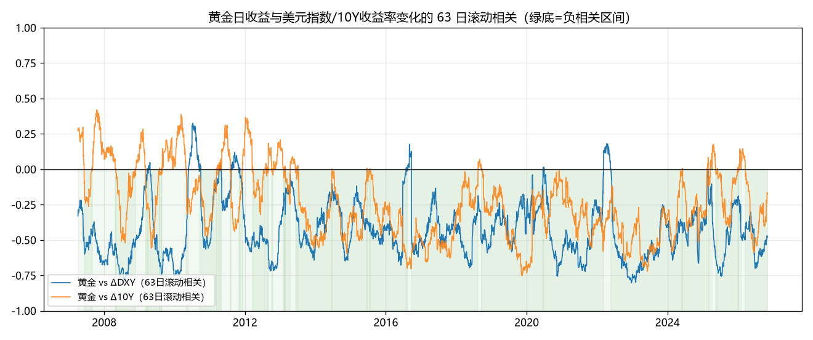
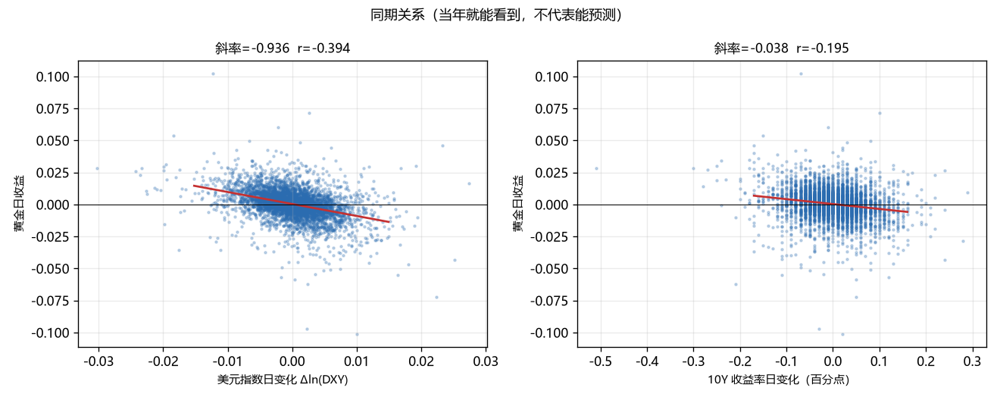
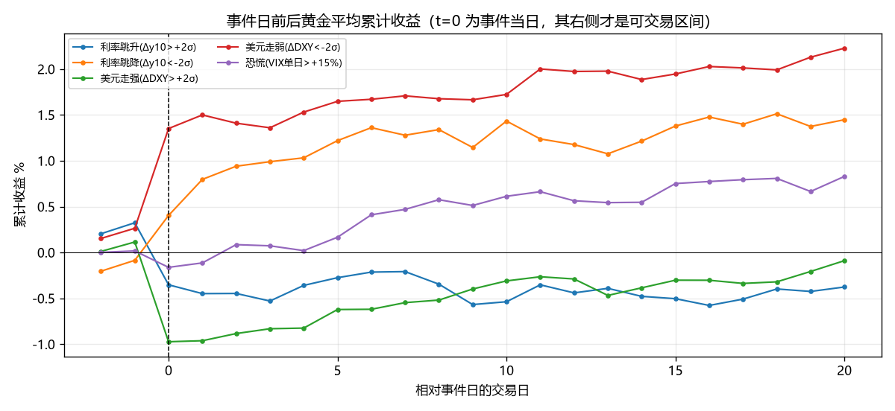

# V6 黄金 · 宏观驱动验证：美元、美债、事件冲击

> 由 `_gold_macro.py` 生成，数据区间 **2007-01-03 ~ 2026-11-03（4942 个共同交易日）**。
> 数据：伦敦金现 XAU/USD（新浪外盘）、ICE 美元指数（东财 100.UDI）、美债 10Y（FRED，仓库 `data/_us10y.csv`）、VIX（仓库 `data/_us_vix.csv`）。
> 口径：黄金、DXY、VIX 用对数收益，10Y 用一阶差（百分点）。**事件研究收益一律从 t+1 起算**，回测信号一律 `t 日收盘生成 → t+1 持仓`，不含前视。

## 1. 一句话结论

1. **「常常相反」是真的，但只在同期，而且强度不高。** 全期日频相关：黄金 vs ΔDXY **-0.394**、vs Δ10Y **-0.195**、vs ΔVIX **-0.051**。方向上确实是负的，但 |r| 只在 0.2~0.4 这个量级 —— 解释不了大部分波动。
   - **跟美元的关系最稳**：6 个分期全在 -0.530 ~ -0.371 之间，没有一期转正。这是唯一可以当「常识」用的那条。
   - **跟美债的关系极不稳定**：分期从 -0.468 到 -0.055。2007-2011 QE 期间基本无关，2016 年后才变强。所谓「黄金盯实际利率」是个**近十年才成立**的叙事，不是历史规律。
   - **跟 VIX 基本无关（-0.051）**。反直觉但很重要：黄金的日波动不跟着股市恐慌走，「避险资产」这个标签在日频尺度上不成立（月频略正，见 §2.2）。
2. **「相反」不能反过来当预测用。** 把 DXY 变化滞后一期，相关从 -0.394 掉到 **-0.014**；10Y 从 -0.195 掉到 **-0.015**。到 5 日累计口径只剩 0.008 / -0.026。也就是说，这个负相关是**当天同时发生的**，等你看到美元跌，金价已经涨完了。
3. **事件效应存在，但只有一类统计显著，且方向是「反弹」不是「跟随」。** 见 §4：
   - **利率跳降（Δy10 < -2σ）后 T+5 平均 +0.8%（t=2.58）、T+20 +1.1%（t=2.08）**—— 全部事件里唯一过 2 倍标准误的。20 年触发 97 次，约 5 次/年。
   - **上/下严重不对称**：利率跳升后 T+5 只有 +0.1%（t=0.31），等于没有。所以这不是「利率降→买黄金」的线性关系，而是**暴跌之后的均值回复**。
   - **美元冲击不论方向，黄金都涨**：美元走强后 +0.4%（t=1.28）、走弱后 +0.3%（t=1.08）。两个方向都为正，说明这是**冲击后的反弹**，不是「美元跌→黄金涨」的传导。按「相反」逻辑去做，会在美元走强那天做空黄金，正好做反。
   - **VIX 恐慌后 T+20 +1.0%（t=2.32）**，虽然显著但只有 134 次样本、单次幅度小，且 T+5 还不显著（+0.3%, t=1.17）—— 要拿满 20 天，等于长期占仓。
4. **毛收益上有一个勉强能看，扣成本立刻死。** 最好的信号是「两者同时或(宽松版)」：年化 +8.3%（基准 +8.0%）、最大回撤 -34.0%（基准 -48.2%）、夏普 0.59（基准 0.52）—— **回撤确实小了一大截，代价是 22 次/年的换手**。
5. **成本只要 2bp 单边，那 0.3pp 的优势就没了**（年化 +7.8% vs 基准 +8.0%）；5bp 明显输（+7.1%）。518880 场内双边价差+佣金约 5bp，000216 场外申赎一次 60bp —— 两条路都过不去。

## 2. 同期相关：存在，但按区间剧烈漂移

### 2.1 日频，全期与分期

| regime | n | c_dxy | c_y10 | c_vix |
|---|---|---|---|---|
| 全期 | 4941 | -0.394 | -0.195 | -0.051 |
| 2007-2011 危机+QE | 1237 | -0.371 | -0.055 | -0.068 |
| 2012-2015 Taper | 998 | -0.385 | -0.215 | -0.066 |
| 2016-2019 加息尾段 | 998 | -0.399 | -0.454 | 0.145 |
| 2020-2021 疫情 | 501 | -0.406 | -0.256 | -0.091 |
| 2022-2023 快速加息 | 498 | -0.530 | -0.468 | -0.025 |
| 2024- 至今 | 709 | -0.424 | -0.178 | -0.153 |

### 2.2 周频 / 月频（降噪后关系更强）

| regime | n | c_dxy | c_y10 | c_vix |
|---|---|---|---|---|
| 全期 | 1034 | -0.450 | -0.206 | -0.004 |
| 2007-2011 危机+QE | 259 | -0.438 | -0.037 | -0.075 |
| 2012-2015 Taper | 208 | -0.439 | -0.317 | 0.141 |
| 2016-2019 加息尾段 | 209 | -0.587 | -0.530 | 0.192 |
| 2020-2021 疫情 | 105 | -0.567 | -0.338 | -0.237 |
| 2022-2023 快速加息 | 104 | -0.444 | -0.352 | 0.019 |
| 2024- 至今 | 149 | -0.322 | -0.129 | -0.048 |

| regime | n | c_dxy | c_y10 | c_vix |
|---|---|---|---|---|
| 全期 | 238 | -0.462 | -0.329 | -0.036 |
| 2007-2011 危机+QE | 59 | -0.467 | -0.290 | -0.065 |
| 2012-2015 Taper | 48 | -0.289 | -0.221 | -0.090 |
| 2016-2019 加息尾段 | 48 | -0.488 | -0.604 | 0.157 |
| 2020-2021 疫情 | 24 | -0.616 | -0.269 | -0.099 |
| 2022-2023 快速加息 | 24 | -0.656 | -0.556 | -0.258 |
| 2024- 至今 | 35 | -0.447 | -0.253 | 0.061 |

> 读法：日频相关被噪声稀释，周频/月频才接近「教科书里的负相关」。但交易是按天做的，频率越高越不可用 —— 这就是这个命题的核心矛盾。

## 3. 预测性：同期显著，滞后归零

| h | n | dxy_same | dxy_fwd | y10_same | y10_fwd |
|---|---|---|---|---|---|
| 1日 | 4941 | -0.394 | -0.014 | -0.195 | -0.015 |
| 2日 | 4941 | -0.394 | -0.007 | -0.195 | -0.022 |
| 5日 | 4941 | -0.394 | 0.008 | -0.195 | -0.026 |
| 10日 | 4941 | -0.394 | 0.013 | -0.195 | -0.037 |
| 20日 | 4941 | -0.394 | 0.008 | -0.195 | -0.015 |

`same` = 当日变化与当日黄金收益的相关；`fwd` = 当日变化与**未来 h 日累计**黄金收益的相关。若 fwd 也显著为负，说明美元/利率领先黄金，可交易；若归零，说明只是同时性。

## 4. 事件研究：冲击之后有没有可交易漂移

事件在 t 日收盘确认（当日 Δ 已发生，无法交易），收益从 t+1 起算。同类事件 5 个交易日内不重复计数。

| event | n | h1_mean | h3_mean | h5_mean | h5_win | h5_t | h10_mean | h20_mean | h20_t |
|---|---|---|---|---|---|---|---|---|---|
| 利率跳升(Δy10>+2σ) | 117 | -0.1% | -0.2% | +0.1% | 59.0% | 0.306 | -0.2% | -0.0% | -0.048 |
| 利率跳降(Δy10<-2σ) | 97 | +0.4% | +0.6% | +0.8% | 54.6% | 2.582 | +1.1% | +1.1% | 2.076 |
| 美元走强(ΔDXY>+2σ) | 106 | +0.0% | +0.1% | +0.4% | 62.3% | 1.277 | +0.7% | +0.9% | 1.696 |
| 美元走弱(ΔDXY<-2σ) | 112 | +0.1% | +0.0% | +0.3% | 55.4% | 1.076 | +0.4% | +0.9% | 1.814 |
| 恐慌(VIX单日>+15%) | 134 | +0.0% | +0.2% | +0.3% | 52.2% | 1.172 | +0.8% | +1.0% | 2.325 |

## 5. 信号回测：能不能变成钱（毛收益、零成本）

先给**零成本**的毛收益尺子（最宽松），再看 §5.1 成本敏感性。逻辑很简单：如果连零成本的毛收益都赢不了买入持有，就不必往下算；如果只赢一点点，就看这点优势够不够付换手成本。

| name | ann | total | mdd | sharpe | calmar | expo | turn |
|---|---|---|---|---|---|---|---|
| 买入持有(基准) | +8.0% | +355.0% | -48.2% | 0.519 | 0.167 | 1.000 | 0.000 |
| DXY<MA200 持有 | +4.8% | +149.6% | -26.6% | 0.453 | 0.180 | 0.446 | 140.000 |
| DXY 20日动量<0 持有 | +6.1% | +222.1% | -29.4% | 0.541 | 0.209 | 0.486 | 451.000 |
| 10Y 20日下行 持有 | +4.0% | +114.1% | -33.0% | 0.365 | 0.120 | 0.485 | 515.000 |
| 两者同时(美元+利率) | +1.9% | +45.5% | -19.6% | 0.255 | 0.098 | 0.262 | 483.000 |
| 两者同时或(宽松版) | +8.3% | +374.0% | -34.0% | 0.591 | 0.243 | 0.709 | 439.000 |
| 反向对照:DXY>MA200 | +2.1% | +50.3% | -33.3% | 0.224 | 0.063 | 0.514 | 139.000 |

`expo` = 平均仓位，`turn` = 累计换手（单位：仓位变动绝对值之和）。

### 5.1 换手成本敏感性（年化收益 vs 单边成本）

| name | turn_per_year | ann_0bp | ann_2bp | ann_5bp | ann_10bp | ann_20bp |
|---|---|---|---|---|---|---|
| 买入持有(基准) | 0.051 | +8.0% | +8.0% | +8.0% | +8.0% | +8.0% |
| DXY<MA200 | 7.139 | +4.8% | +4.6% | +4.4% | +4.0% | +3.3% |
| 两者同时或(宽松版) | 22.385 | +8.3% | +7.8% | +7.1% | +5.9% | +3.5% |
| 两者同时(美元+利率) | 24.629 | +1.9% | +1.4% | +0.7% | -0.6% | -3.0% |

> 这一栏是全文最硬的证据：**信号的优势幅度（0.3pp）小于任何真实成本**。基准零换手，成本对它无效；所有依赖「20 日动量/均线」的信号都被换手吃穿。

## 6. 局限

1. **XAU 是美元金价（伦敦金现），不是你能买的标的。** 人民币金价（518880 / 000216）多一层汇率，USDCNY 与 DXY 并非同向，负相关会被削弱甚至翻转。这是本次结论「在美元金上都不够用，在人民币金上只会更弱」的直接理由。
2. **10Y 是名义利率，不是实际利率。** 理论框架用的是 TIPS 实际利率，但仓库无 TIPS 数据；名义利率混入了通胀预期，方向解释力更差。
3. **事件只用「市场冲击」代理（2σ 跳变、VIX+15%），不是真日历事件。** 仓库无 CPI/FOMC 日历数据，硬编码日期容易出错且不可维护。冲击型事件研究的好处是不依赖日历、完全可复现。
4. **样本内。** 所有区间都参与了观察，没有做真正的样本外。不过 §5 的结论是「全都更差」，这类否定性结论对过拟合不敏感。
5. 2022 年之后负相关的弱化在 §2 的分期表里直接可见 —— 与 v6 外部研究清单（`research/external_ideas/_v6_external_ideas.md` §1 末行）引用的外部结论一致。
